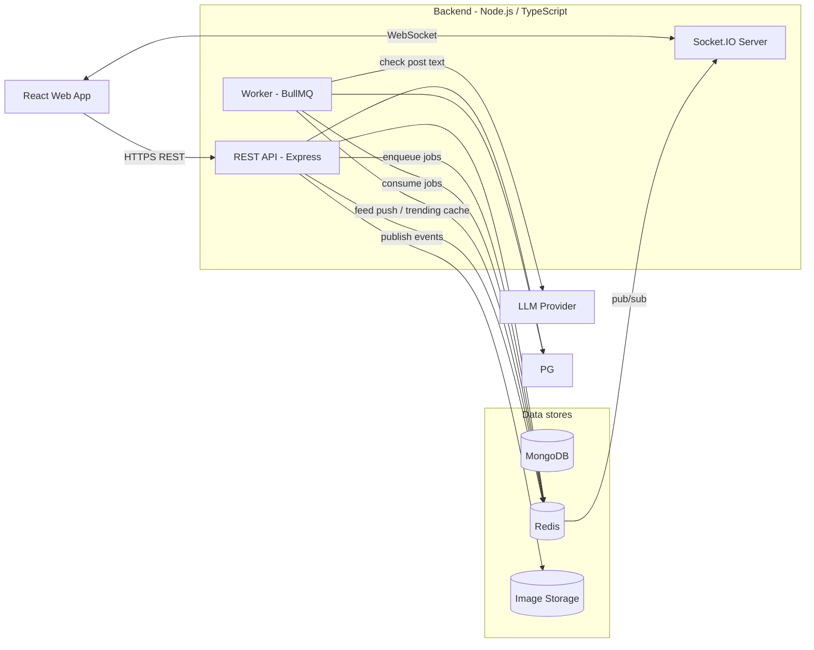
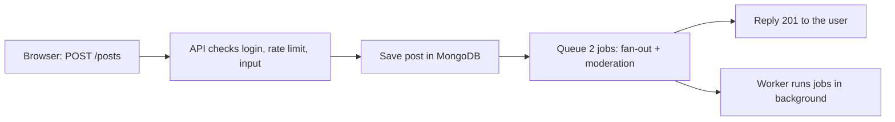
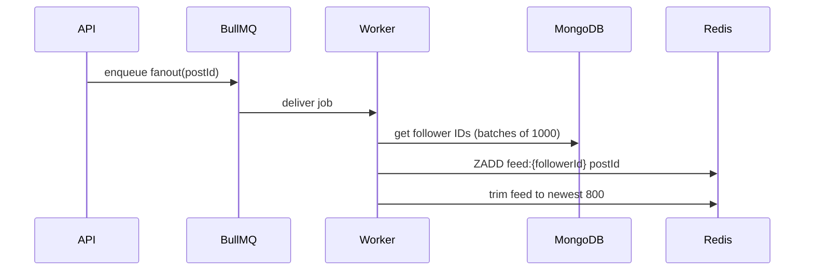
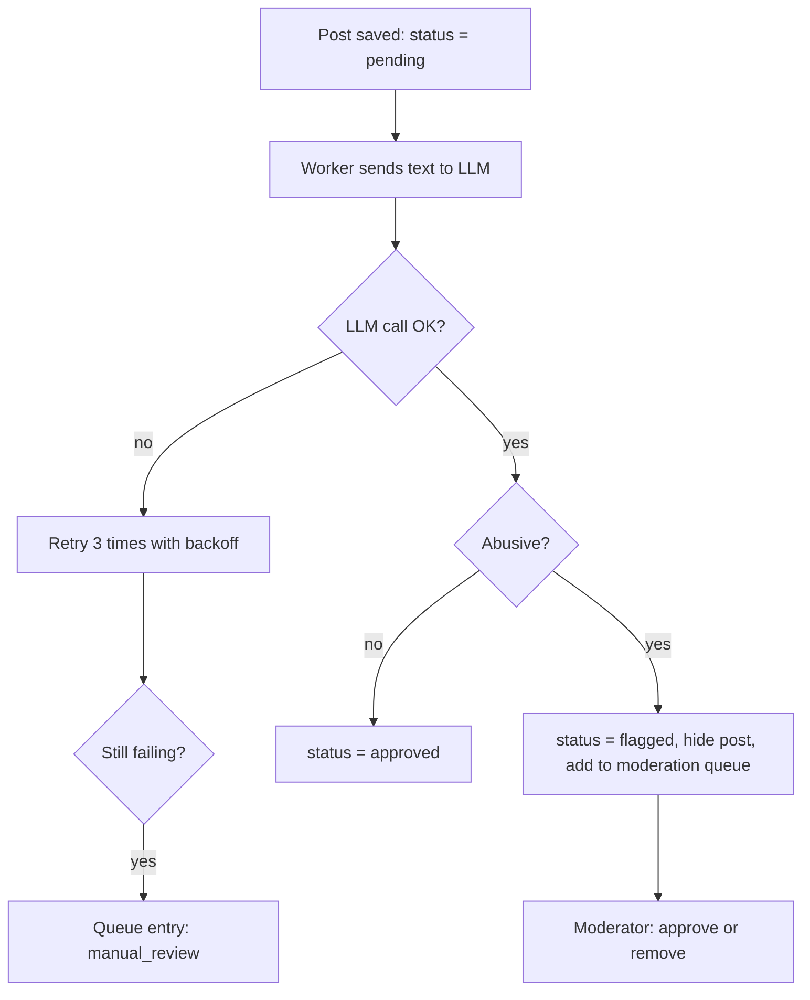

# Micro-blogging Social Network: Architecture

## 1. Overview

The system has four running parts: a **React web app**, a **REST API** with a **Socket.IO** server, a **background worker**, and two data stores, **MongoDB** and **Redis**.

MongoDB is the source of truth. Redis is only a speed layer (feeds, counters, queues, cache), so anything in Redis can be rebuilt from MongoDB.

## 2. Architecture Diagram

## 3. Components

| Component | Technology | Job |
|---|---|---|
| Web app | React + Vite + TanStack Query | All screens; infinite scroll; listens for live events |
| REST API | Node.js + Express + Zod | Auth, posts, follows, feed, search; validates every request |
| Socket.IO server | Socket.IO | Pushes live like/repost counts and notifications |
| Worker | BullMQ | Slow jobs: feed fan-out, trending, AI moderation |
| Database | MongoDB + Mongoose | Permanent data (users, posts, follows, likes, ...) |
| Redis | Redis (Docker) + ioredis | Home feeds, rate-limit counters, trending cache, job queues |
| Image storage | Cloudinary / R2 | Avatars and post images |
| LLM provider | Any LLM behind an adapter | Checks post text for abuse |

## 4. Main Flows

### 4.1 Create a post

The user gets a reply as soon as the post is saved. Slow work happens afterwards.

### 4.2 Fast home feed (fan-out on write)

When a user posts, the worker copies the post ID into every follower's Redis feed (`feed:{userId}`, a sorted set capped at 800 IDs). When a follower opens Home, the API reads the ID list from Redis, loads those posts from MongoDB in one query, and returns 20 at a time. Only IDs are stored in Redis, so deletes and count changes always stay correct.

**Cursor pagination.** The client sends the last post ID it saw (`cursor`) and gets posts older than it. New posts never shift the pages.

**If Redis is down**, the API builds the feed from MongoDB instead (slower, still correct).

### 4.3 Real-time updates

After a like, repost or reply is saved, the API publishes an event. The Socket.IO server sends:

- `post:counts` to everyone viewing that post (room `post:{id}`)
- `notification:new` to the affected user (room `user:{id}`)

Sockets must be authenticated with the access token. If a socket disconnects, the client reconnects and refetches counts through REST.

### 4.4 Background jobs

Three BullMQ queues, all with retries and backoff:

- **fanout**: runs for each new post
- **moderation**: runs for each new post
- **trending**: repeats every 5 minutes, counts hashtags from the last 24 hours and caches the top list in Redis

### 4.5 AI moderation

Posts are published first and hidden only if flagged, so the LLM never slows or blocks posting.

## 5. Redis Keys

| Key | Type | Purpose |
|---|---|---|
| `feed:{userId}` | Sorted set | Home feed post IDs (newest 800) |
| `trending:hashtags` | JSON | Cached top hashtags, refreshed every ~5 min |
| `ratelimit:post:{userId}` | Counter + TTL | Posting limit (10 per minute) |
| `bull:*` | BullMQ | Job queues |

## 6. Key Design Decisions

- **Fan-out on write** makes reading fast. The cost is paid once, in the background, when posting.
- **IDs only in Redis**, so privacy, block, mute and delete rules are re-checked when the feed is read.
- **Counters change in the same database transaction** as the follow/like row, and only if a row really changed. This keeps counts correct under concurrent requests.
- **Stateless API**, so more API instances can be added behind a load balancer.
- **Failures never lose data:** Redis down uses the database feed; LLM down retries, then goes to manual review.

## 7. Deployment

| Part | Where (recommended) |
|---|---|
| Web app | Vercel or Netlify |
| API + worker | Render, Railway or Fly.io |
| MongoDB | Neon or Supabase |
| Redis | Upstash or Render |
| Local development | docker-compose runs MongoDB and Redis |
