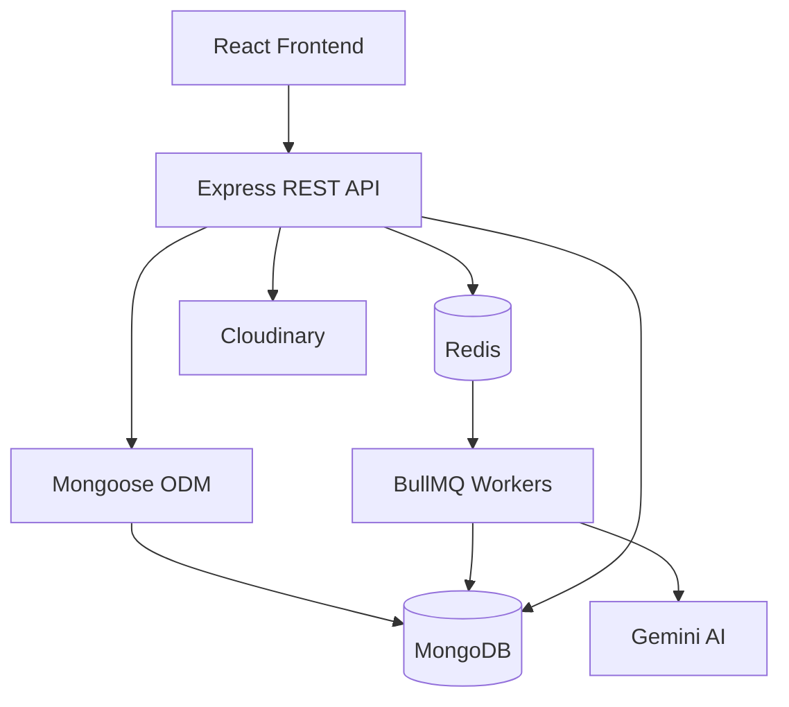
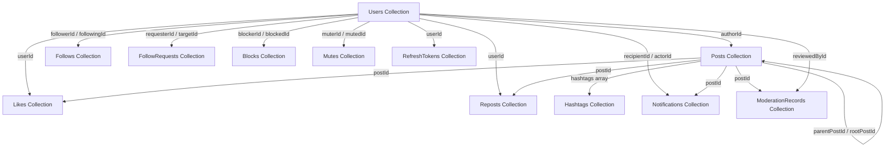
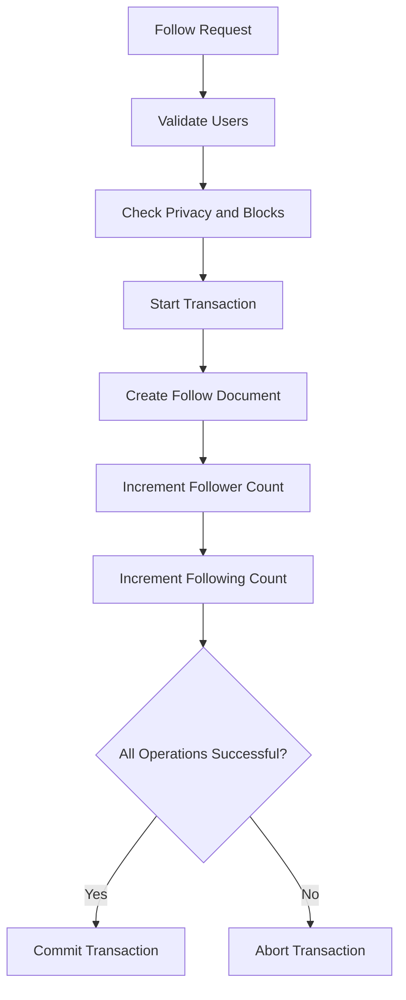
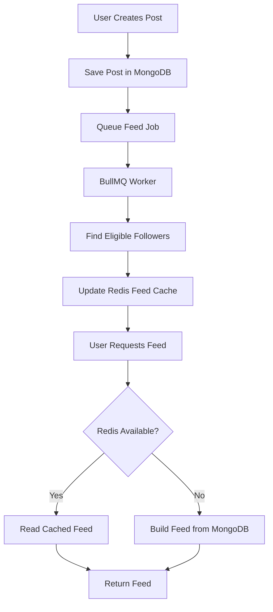

# Database Schema Documentation
**Title** Chripwell
**Version:** 1.0  
**Database:** MongoDB  
**ODM:** Mongoose  
**Database Mode:** Document-Oriented NoSQL  
**ID Strategy:** MongoDB ObjectId  
**Architecture:** Referenced Documents + Selective Embedding

---

## 1. Introduction

This document defines the database architecture and schema design for Chripwell (Blogging platform) using MongoDB and Mongoose.

The database design is based on the functional requirements defined in the ConnectX SRS.

### Database Objectives

- Store user accounts and profile information.
- Manage posts, replies and media references.
- Maintain follow relationships and private account requests.
- Track likes, reposts and notifications.
- Support hashtags, mentions and search.
- Store AI moderation records.
- Maintain secure refresh-token sessions.
- Optimize database queries through indexing.

### Database Design Principles

1. Use MongoDB collections instead of relational tables.
2. Use `ObjectId` for document identification.
3. Use references for independently managed relationships.
4. Embed small, closely related data where appropriate.
5. Avoid unnecessary document duplication.
6. Use indexes for frequently queried fields.
7. Use transactions for operations involving multiple collections.
8. Maintain counters carefully using atomic updates.
9. Keep large or frequently growing arrays in separate collections.
10. Use Redis for caching and feed optimization, not as the permanent source of truth.

---

## 2. Database Architecture

ConnectX uses MongoDB as its primary database.

Mongoose provides schema definitions, validation, relationships and database operations.

### Database Components

| Component | Responsibility |
|---|---|
| MongoDB | Permanent application data |
| Mongoose | ODM and schema management |
| Redis | Feed caching, counters, rate limits and queues |
| BullMQ | Background job processing |
| Cloudinary | Profile and post image storage |
| Gemini AI | Content moderation |

### Architecture Overview



### Data Storage Rules

| Data | Storage |
|---|---|
| Users and profiles | MongoDB |
| Posts and replies | MongoDB |
| Likes and reposts | MongoDB |
| Followers and following | MongoDB |
| Notifications | MongoDB |
| Moderation records | MongoDB |
| Refresh-token hashes | MongoDB |
| Feed cache | Redis |
| Rate limits | Redis |
| Uploaded images | Cloudinary |

MongoDB remains the source of truth for permanent application data.

---

## 3. Collection Overview

The original relational entities are adapted into MongoDB collections and embedded documents.

| No. | Collection | Purpose |
|---:|---|---|
| 1 | `users` | Authentication and user profiles |
| 2 | `posts` | Posts and threaded replies |
| 3 | `follows` | Follow relationships |
| 4 | `followRequests` | Private account follow requests |
| 5 | `likes` | Post likes |
| 6 | `reposts` | Post reposts |
| 7 | `hashtags` | Hashtag information |
| 8 | `notifications` | User notifications |
| 9 | `blocks` | Block relationships |
| 10 | `mutes` | Mute relationships |
| 11 | `moderationRecords` | AI and admin moderation history |
| 12 | `refreshTokens` | Refresh-token sessions |

### Embedded Data

The following relational entities do not require separate collections in this design:

| Original Entity | MongoDB Implementation |
|---|---|
| Profiles | Embedded inside `users` |
| PostHashtags | Hashtag strings embedded in `posts` |
| PostMentions | Mentioned user IDs embedded in `posts` |

This reduces unnecessary collection joins and simplifies common read operations.

---

## 4. Common Data Conventions

### ObjectId

Every MongoDB document uses `_id` as its primary identifier.

Example:

```json
{
  "_id": "ObjectId('672a12345678901234567890')"
}
```

### Common Fields

| Field | Type | Description |
|---|---|---|
| `_id` | ObjectId | Unique document identifier |
| `createdAt` | Date | Document creation timestamp |
| `updatedAt` | Date | Last modification timestamp |

Mongoose timestamps should be enabled for collections that need automatic creation and update timestamps.

### Reference Convention

References use MongoDB ObjectId values.

Example:

```json
{
  "authorId": "ObjectId('672a12345678901234567890')"
}
```

The referenced document can be retrieved using Mongoose `populate()` or explicit queries.

### Naming Convention

- Collection names use plural camelCase.
- Schema fields use camelCase.
- References use the `Id` suffix.
- Boolean fields use `is` or `has` prefixes where appropriate.
- Enum values use uppercase strings.

---

## 5. Collection Schemas

### 5.1 Users Collection

**Collection:** `users`

Stores authentication information, account settings and profile information.

The profile is embedded inside the user document.

| Field | Type | Required | Description |
|---|---|---|---|
| `_id` | ObjectId | Yes | User ID |
| `email` | String | Yes | Unique email |
| `emailNormalized` | String | Yes | Lowercase normalized email |
| `username` | String | Yes | Unique username |
| `usernameNormalized` | String | Yes | Lowercase normalized username |
| `passwordHash` | String | Yes | Hashed password |
| `role` | String | Yes | USER / ADMIN |
| `profile.displayName` | String | Yes | Display name |
| `profile.bio` | String | No | User biography |
| `profile.avatarUrl` | String | No | Cloudinary image URL |
| `profile.avatarPublicId` | String | No | Cloudinary public ID |
| `profile.isPrivate` | Boolean | Yes | Account privacy setting |
| `profile.followerCount` | Number | Yes | Follower count |
| `profile.followingCount` | Number | Yes | Following count |
| `createdAt` | Date | Yes | Account creation time |
| `updatedAt` | Date | Yes | Last update time |

### Example Document

```json
{
  "_id": "ObjectId('672a12345678901234567890')",
  "email": "akash@example.com",
  "emailNormalized": "akash@example.com",
  "username": "akash_paira",
  "usernameNormalized": "akash_paira",
  "passwordHash": "bcrypt_hashed_password",
  "role": "USER",
  "profile": {
    "displayName": "Akash Paira",
    "bio": "Full Stack Developer",
    "avatarUrl": "https://res.cloudinary.com/example/avatar.jpg",
    "avatarPublicId": "connectx/avatars/user123",
    "isPrivate": false,
    "followerCount": 120,
    "followingCount": 85
  },
  "createdAt": "2026-11-06T05:00:00.000Z",
  "updatedAt": "2026-11-06T05:00:00.000Z"
}
```

### Validation Rules

- Email must be valid and unique.
- Username must be 3–20 characters.
- Username supports letters, numbers and underscores.
- Password must contain at least 8 characters, including a letter and number.
- Password must never be stored in plain text.
- Display name maximum: 50 characters.
- Bio maximum: 160 characters.
- Avatar formats: JPEG, PNG and WebP.
- Avatar maximum size: 2 MB.

### Important Indexes

```javascript
db.users.createIndex(
  { emailNormalized: 1 },
  { unique: true }
);

db.users.createIndex(
  { usernameNormalized: 1 },
  { unique: true }
);
```

---

### 5.2 Posts Collection

**Collection:** `posts`

Stores both normal posts and replies.

Replies are implemented using self-referencing documents instead of a separate replies collection.

| Field | Type | Required | Description |
|---|---|---|---|
| `_id` | ObjectId | Yes | Post ID |
| `authorId` | ObjectId | Yes | Reference to Users |
| `content` | String | Conditional | Post text |
| `imageUrl` | String | No | Cloudinary image URL |
| `imagePublicId` | String | No | Cloudinary public ID |
| `parentPostId` | ObjectId | No | Parent post or reply |
| `rootPostId` | ObjectId | No | Original thread post |
| `mentionedUserIds` | ObjectId[] | No | Mentioned users |
| `hashtags` | String[] | No | Normalized hashtags |
| `likeCount` | Number | Yes | Total likes |
| `repostCount` | Number | Yes | Total reposts |
| `replyCount` | Number | Yes | Total replies |
| `moderationStatus` | String | Yes | PENDING / APPROVED / FLAGGED / REJECTED |
| `editedAt` | Date | No | Last edit time |
| `deletedAt` | Date | No | Soft deletion time |
| `createdAt` | Date | Yes | Creation time |
| `updatedAt` | Date | Yes | Last update time |

### Example Document

```json
{
  "_id": "ObjectId('672a22345678901234567890')",
  "authorId": "ObjectId('672a12345678901234567890')",
  "content": "Learning MongoDB with #NodeJS and #Mongoose",
  "imageUrl": null,
  "imagePublicId": null,
  "parentPostId": null,
  "rootPostId": null,
  "mentionedUserIds": [],
  "hashtags": ["nodejs", "mongoose"],
  "likeCount": 12,
  "repostCount": 3,
  "replyCount": 5,
  "moderationStatus": "APPROVED",
  "editedAt": null,
  "deletedAt": null,
  "createdAt": "2026-11-06T05:30:00.000Z",
  "updatedAt": "2026-11-06T05:30:00.000Z"
}
```

### Reply Document Example

```json
{
  "_id": "ObjectId('672a32345678901234567890')",
  "authorId": "ObjectId('672a12345678901234567890')",
  "content": "Great explanation!",
  "parentPostId": "ObjectId('672a22345678901234567890')",
  "rootPostId": "ObjectId('672a22345678901234567890')",
  "hashtags": [],
  "mentionedUserIds": [],
  "likeCount": 0,
  "repostCount": 0,
  "replyCount": 0,
  "moderationStatus": "APPROVED",
  "createdAt": "2026-11-06T05:35:00.000Z"
}
```

### Post Rules

- Maximum 280 characters.
- One image per post.
- Image maximum size: 5 MB.
- Supported formats: JPEG, PNG and WebP.
- A post must contain text or an image.
- Replies use `parentPostId` and `rootPostId`.
- Normal posts have both fields set to `null`.
- Replies must not appear in the home feed.
- Deleted posts use soft deletion.
- Hashtags are stored in lowercase.
- Mentioned users are stored as ObjectId references.

### Important Indexes

```javascript
db.posts.createIndex({
  authorId: 1,
  createdAt: -1,
  _id: -1
});

db.posts.createIndex({
  parentPostId: 1,
  createdAt: 1,
  _id: 1
});

db.posts.createIndex({
  rootPostId: 1
});

db.posts.createIndex({
  createdAt: -1,
  _id: -1
});

db.posts.createIndex({
  hashtags: 1,
  createdAt: -1
});

db.posts.createIndex({
  moderationStatus: 1,
  createdAt: -1
});
```

---

### 5.3 Follows Collection

**Collection:** `follows`

Stores follower and following relationships.

| Field | Type | Required | Description |
|---|---|---|---|
| `_id` | ObjectId | Yes | Relationship ID |
| `followerId` | ObjectId | Yes | User who follows |
| `followingId` | ObjectId | Yes | User being followed |
| `createdAt` | Date | Yes | Follow time |

### Example Document

```json
{
  "_id": "ObjectId('673a12345678901234567890')",
  "followerId": "ObjectId('672a12345678901234567890')",
  "followingId": "ObjectId('672a22345678901234567890')",
  "createdAt": "2026-11-06T06:00:00.000Z"
}
```

### Rules

- A user cannot follow themselves.
- One user can follow another user only once.
- Public accounts can be followed immediately.
- Private accounts require approval.
- Unfollow removes the relationship.

### Important Indexes

```javascript
db.follows.createIndex(
  { followerId: 1, followingId: 1 },
  { unique: true }
);

db.follows.createIndex({
  followingId: 1,
  createdAt: -1
});

db.follows.createIndex({
  followerId: 1,
  createdAt: -1
});
```

---

### 5.4 FollowRequests Collection

**Collection:** `followRequests`

Stores pending requests to follow private accounts.

| Field | Type | Required | Description |
|---|---|---|---|
| `_id` | ObjectId | Yes | Request ID |
| `requesterId` | ObjectId | Yes | Requesting user |
| `targetId` | ObjectId | Yes | Private account owner |
| `createdAt` | Date | Yes | Request creation time |

### Example Document

```json
{
  "_id": "ObjectId('674a12345678901234567890')",
  "requesterId": "ObjectId('672a12345678901234567890')",
  "targetId": "ObjectId('672a22345678901234567890')",
  "createdAt": "2026-11-06T06:10:00.000Z"
}
```

### Rules

- One pending request per requester-target pair.
- A user cannot request to follow themselves.
- Accepting a request creates a follow relationship.
- Rejecting or cancelling a request deletes the pending document.

### Important Indexes

```javascript
db.followRequests.createIndex(
  { requesterId: 1, targetId: 1 },
  { unique: true }
);

db.followRequests.createIndex({
  targetId: 1,
  createdAt: -1
});
```

---

### 5.5 Likes Collection

**Collection:** `likes`

Stores user likes on posts.

| Field | Type | Required | Description |
|---|---|---|---|
| `_id` | ObjectId | Yes | Like ID |
| `userId` | ObjectId | Yes | User who liked |
| `postId` | ObjectId | Yes | Liked post |
| `createdAt` | Date | Yes | Like time |

### Example Document

```json
{
  "_id": "ObjectId('675a12345678901234567890')",
  "userId": "ObjectId('672a12345678901234567890')",
  "postId": "ObjectId('672a22345678901234567890')",
  "createdAt": "2026-11-06T06:20:00.000Z"
}
```

### Rules

- One user can like a post only once.
- Duplicate likes are prevented through a unique compound index.
- Unlike removes the corresponding document.
- Post like counters must be updated consistently.

### Important Indexes

```javascript
db.likes.createIndex(
  { userId: 1, postId: 1 },
  { unique: true }
);

db.likes.createIndex({
  postId: 1,
  createdAt: -1
});
```

---

### 5.6 Reposts Collection

**Collection:** `reposts`

Stores repost relationships.

| Field | Type | Required | Description |
|---|---|---|---|
| `_id` | ObjectId | Yes | Repost ID |
| `userId` | ObjectId | Yes | Reposting user |
| `postId` | ObjectId | Yes | Original post |
| `createdAt` | Date | Yes | Repost time |

### Example Document

```json
{
  "_id": "ObjectId('676a12345678901234567890')",
  "userId": "ObjectId('672a12345678901234567890')",
  "postId": "ObjectId('672a22345678901234567890')",
  "createdAt": "2026-11-06T06:30:00.000Z"
}
```

### Rules

- One repost per user per post.
- Private posts cannot be reposted.
- Block restrictions must be checked.
- Repost counters must be updated consistently.

### Important Indexes

```javascript
db.reposts.createIndex(
  { userId: 1, postId: 1 },
  { unique: true }
);

db.reposts.createIndex({
  userId: 1,
  createdAt: -1
});

db.reposts.createIndex({
  postId: 1,
  createdAt: -1
});
```

---

### 5.7 Hashtags Collection

**Collection:** `hashtags`

Stores hashtag information and aggregate counts.

| Field | Type | Required | Description |
|---|---|---|---|
| `_id` | ObjectId | Yes | Hashtag ID |
| `tag` | String | Yes | Normalized hashtag |
| `postCount` | Number | Yes | Total associated posts |
| `createdAt` | Date | Yes | Creation time |
| `updatedAt` | Date | Yes | Last update time |

### Example Document

```json
{
  "_id": "ObjectId('677a12345678901234567890')",
  "tag": "nodejs",
  "postCount": 120,
  "createdAt": "2026-11-06T06:40:00.000Z",
  "updatedAt": "2026-11-06T06:40:00.000Z"
}
```

### Rules

- Hashtags are extracted from post content.
- Hashtags are stored in lowercase.
- Duplicate hashtag documents are not allowed.
- Trending is calculated using public posts from the last 24 hours.
- Trending data refreshes every 5 minutes.

### Important Index

```javascript
db.hashtags.createIndex(
  { tag: 1 },
  { unique: true }
);
```

**Important:** `postCount` is a lifetime aggregate and must not be used alone to calculate 24-hour trending. Trending should use recent post data or a time-window aggregation.

---

### 5.8 Notifications Collection

**Collection:** `notifications`

Stores notifications generated by user activities and moderation events.

| Field | Type | Required | Description |
|---|---|---|---|
| `_id` | ObjectId | Yes | Notification ID |
| `recipientId` | ObjectId | Yes | Notification receiver |
| `actorId` | ObjectId | No | User who triggered event |
| `type` | String | Yes | Notification type |
| `postId` | ObjectId | No | Related post |
| `groupKey` | String | Yes | Notification grouping key |
| `isRead` | Boolean | Yes | Read status |
| `createdAt` | Date | Yes | Creation time |

### Supported Types

```text
LIKE
REPOST
REPLY
MENTION
FOLLOW
FOLLOW_REQUEST
FOLLOW_ACCEPTED
MODERATION
```

### Example Document

```json
{
  "_id": "ObjectId('678a12345678901234567890')",
  "recipientId": "ObjectId('672a12345678901234567890')",
  "actorId": "ObjectId('672a22345678901234567890')",
  "type": "LIKE",
  "postId": "ObjectId('672a32345678901234567890')",
  "groupKey": "LIKE:672a32345678901234567890",
  "isRead": false,
  "createdAt": "2026-11-06T07:00:00.000Z"
}
```

### Rules

- Notifications belong to a recipient.
- Actor may be null for system-generated notifications.
- Similar events can be grouped using `groupKey`.
- Users can mark individual groups or all notifications as read.
- Notifications must respect block and privacy rules.

### Important Indexes

```javascript
db.notifications.createIndex({
  recipientId: 1,
  createdAt: -1,
  _id: -1
});

db.notifications.createIndex({
  recipientId: 1,
  isRead: 1
});

db.notifications.createIndex({
  recipientId: 1,
  groupKey: 1
});
```

---

### 5.9 Blocks Collection

**Collection:** `blocks`

Stores user blocking relationships.

| Field | Type | Required | Description |
|---|---|---|---|
| `_id` | ObjectId | Yes | Block ID |
| `blockerId` | ObjectId | Yes | User who blocks |
| `blockedId` | ObjectId | Yes | User being blocked |
| `createdAt` | Date | Yes | Block time |

### Example Document

```json
{
  "_id": "ObjectId('679a12345678901234567890')",
  "blockerId": "ObjectId('672a12345678901234567890')",
  "blockedId": "ObjectId('672a22345678901234567890')",
  "createdAt": "2026-11-06T07:10:00.000Z"
}
```

### Rules

- A user cannot block themselves.
- Duplicate block relationships are not allowed.
- Blocking removes follow relationships in both directions.
- Blocked users cannot interact with each other.
- Blocked content must be excluded from feeds and search.

### Important Indexes

```javascript
db.blocks.createIndex(
  { blockerId: 1, blockedId: 1 },
  { unique: true }
);

db.blocks.createIndex({
  blockedId: 1
});
```

---

### 5.10 Mutes Collection

**Collection:** `mutes`

Stores user mute relationships.

| Field | Type | Required | Description |
|---|---|---|---|
| `_id` | ObjectId | Yes | Mute ID |
| `muterId` | ObjectId | Yes | User who mutes |
| `mutedId` | ObjectId | Yes | User being muted |
| `createdAt` | Date | Yes | Mute time |

### Example Document

```json
{
  "_id": "ObjectId('67aa12345678901234567890')",
  "muterId": "ObjectId('672a12345678901234567890')",
  "mutedId": "ObjectId('672a22345678901234567890')",
  "createdAt": "2026-11-06T07:20:00.000Z"
}
```

### Rules

- A user cannot mute themselves.
- Duplicate mute relationships are not allowed.
- Muting does not remove the follow relationship.
- Muted posts and notifications are hidden from the muting user.
- Users can unmute at any time.

### Important Index

```javascript
db.mutes.createIndex(
  { muterId: 1, mutedId: 1 },
  { unique: true }
);
```

---

### 5.11 ModerationRecords Collection

**Collection:** `moderationRecords`

Stores AI moderation results and admin review decisions.

| Field | Type | Required | Description |
|---|---|---|---|
| `_id` | ObjectId | Yes | Moderation record ID |
| `postId` | ObjectId | Yes | Related post |
| `aiVerdict` | String | Yes | SAFE / FLAGGED / ERROR |
| `categories` | String[] | No | Violation categories |
| `confidence` | Number | No | AI confidence score |
| `aiReason` | String | No | AI explanation |
| `reviewStatus` | String | Yes | NOT_REQUIRED / PENDING_REVIEW / APPROVED / REJECTED |
| `reviewedById` | ObjectId | No | Admin reviewer |
| `reviewNote` | String | No | Admin review note |
| `reviewedAt` | Date | No | Review time |
| `createdAt` | Date | Yes | Record creation time |

### Example Document

```json
{
  "_id": "ObjectId('67ba12345678901234567890')",
  "postId": "ObjectId('672a22345678901234567890')",
  "aiVerdict": "FLAGGED",
  "categories": ["HARASSMENT"],
  "confidence": 0.92,
  "aiReason": "Potential targeted harassment detected",
  "reviewStatus": "PENDING_REVIEW",
  "reviewedById": null,
  "reviewNote": null,
  "reviewedAt": null,
  "createdAt": "2026-11-06T07:30:00.000Z"
}
```

### Rules

- Every moderation run creates a separate record.
- New and edited posts trigger AI moderation.
- Flagged posts remain hidden until admin review.
- Admin can approve or reject a flagged post.
- AI failure must not block post creation.
- Moderation history should be retained.

### Important Indexes

```javascript
db.moderationRecords.createIndex({
  reviewStatus: 1,
  createdAt: 1
});

db.moderationRecords.createIndex({
  postId: 1,
  createdAt: -1
});
```

---

### 5.12 RefreshTokens Collection

**Collection:** `refreshTokens`

Stores refresh-token session information.

Actual refresh tokens must never be stored in plain text.

| Field | Type | Required | Description |
|---|---|---|---|
| `_id` | ObjectId | Yes | Session ID |
| `userId` | ObjectId | Yes | Token owner |
| `tokenHash` | String | Yes | SHA-256 token hash |
| `familyId` | ObjectId | Yes | Token rotation family |
| `expiresAt` | Date | Yes | Token expiration time |
| `revokedAt` | Date | No | Revocation time |
| `createdAt` | Date | Yes | Session creation time |

### Example Document

```json
{
  "_id": "ObjectId('67ca12345678901234567890')",
  "userId": "ObjectId('672a12345678901234567890')",
  "tokenHash": "sha256_hash_value",
  "familyId": "ObjectId('67da12345678901234567890')",
  "expiresAt": "2026-11-13T07:30:00.000Z",
  "revokedAt": null,
  "createdAt": "2026-11-06T07:30:00.000Z"
}
```

### Rules

- Store only the hash of the refresh token.
- Rotate refresh tokens on every successful refresh.
- Revoke the session on logout.
- Detect reuse of previously rotated tokens.
- Revoke the associated token family if token reuse is detected.

### Important Indexes

```javascript
db.refreshTokens.createIndex(
  { tokenHash: 1 },
  { unique: true }
);

db.refreshTokens.createIndex({
  userId: 1
});

db.refreshTokens.createIndex({
  familyId: 1
});

db.refreshTokens.createIndex(
  { expiresAt: 1 },
  { expireAfterSeconds: 0 }
);
```

**TTL Note:** MongoDB TTL deletion is asynchronous. Expired tokens must still be rejected by application logic using `expiresAt`, even if the document has not yet been removed.

---

## 6. Entity Relationships

MongoDB does not use traditional foreign keys.

Relationships are maintained through ObjectId references and application-level validation.

### Relationship Overview

| Collection | Related Collection | Relationship |
|---|---|---|
| Users | Posts | One-to-Many |
| Users | Follows | One-to-Many |
| Users | FollowRequests | One-to-Many |
| Users | Likes | One-to-Many |
| Users | Reposts | One-to-Many |
| Users | Notifications | One-to-Many |
| Users | Blocks | One-to-Many |
| Users | Mutes | One-to-Many |
| Users | RefreshTokens | One-to-Many |
| Posts | Posts | Self-referencing replies |
| Posts | Likes | One-to-Many |
| Posts | Reposts | One-to-Many |
| Posts | ModerationRecords | One-to-Many |
| Users | Profiles | Embedded one-to-one |
| Posts | Hashtags | Embedded hashtag references |
| Posts | Mentions | Embedded user references |

### Relationship Diagram



---

## 7. Embedding vs Referencing Strategy

MongoDB supports two major relationship strategies.

### Embedded Documents

Related information is stored inside the same document.

Used for:

- User profile information inside `users`.
- Hashtag strings inside `posts`.
- Mentioned user IDs inside `posts`.

### Referenced Documents

Related information is stored in separate collections and connected through ObjectIds.

Used for:

- Users and posts.
- Users and followers.
- Users and likes.
- Posts and reposts.
- Users and notifications.
- Posts and moderation records.

### Design Comparison

| Data | Strategy | Reason |
|---|---|---|
| User profile | Embed | Frequently accessed with user |
| Posts | Reference | Independently queried and updated |
| Replies | Reference | Supports threaded discussions |
| Likes | Reference | Can grow significantly |
| Reposts | Reference | Independently managed |
| Followers | Reference | Avoid unbounded arrays |
| Notifications | Reference | Can grow significantly |
| Hashtags | Embed + separate collection | Fast post reads and hashtag lookup |
| Mentions | Embed | Small list of referenced IDs |
| Moderation history | Reference | Multiple moderation runs per post |

**Important:** Do not store all followers, likes, reposts or notifications in arrays inside a user or post document. These relationships can grow without a predictable limit.

---

## 8. Indexing Strategy

Indexes improve query performance by reducing unnecessary collection scans.

### Required Indexes

| Collection | Index | Purpose |
|---|---|---|
| users | `emailNormalized` unique | Login and registration |
| users | `usernameNormalized` unique | Profile lookup |
| posts | `authorId + createdAt + _id` | Profile posts |
| posts | `parentPostId + createdAt + _id` | Thread replies |
| posts | `rootPostId` | Thread lookup |
| posts | `hashtags + createdAt` | Hashtag posts |
| posts | `moderationStatus + createdAt` | Moderation queue |
| follows | `followerId + followingId` unique | Prevent duplicate follows |
| follows | `followingId + createdAt` | Followers list |
| followRequests | `requesterId + targetId` unique | Prevent duplicate requests |
| likes | `userId + postId` unique | Prevent duplicate likes |
| reposts | `userId + postId` unique | Prevent duplicate reposts |
| hashtags | `tag` unique | Hashtag lookup |
| notifications | `recipientId + createdAt + _id` | Notification pagination |
| blocks | `blockerId + blockedId` unique | Prevent duplicate blocks |
| mutes | `muterId + mutedId` unique | Prevent duplicate mutes |
| moderationRecords | `reviewStatus + createdAt` | Admin review queue |
| refreshTokens | `tokenHash` unique | Token validation |

### Indexing Rules

- Create indexes based on actual query patterns.
- Avoid unnecessary indexes because they increase write overhead.
- Use compound indexes for frequently combined filters and sorts.
- Verify query plans using `explain("executionStats")`.
- Review index usage during performance testing.

---

## 9. Database Transactions and Counter Management

MongoDB supports multi-document transactions when running as a replica set or supported sharded cluster.

Transactions are required when a business operation changes multiple related documents.

### Example: Following a User

When a user follows another user:

1. Verify that both users exist.
2. Check privacy and block restrictions.
3. Create the follow relationship.
4. Increment the follower count of the target user.
5. Increment the following count of the requesting user.

These changes should succeed or fail together.

### Example Transaction Flow



### Counters Requiring Consistency

| Counter | Updated When |
|---|---|
| `followerCount` | Follow / Unfollow |
| `followingCount` | Follow / Unfollow |
| `likeCount` | Like / Unlike |
| `repostCount` | Repost / Undo repost |
| `replyCount` | Create / Delete reply |

### Important Rules

- Use atomic updates such as `$inc`.
- Prevent duplicate operations through unique indexes.
- Update counters only when the relationship is actually created or removed.
- Use transactions when multiple documents must remain consistent.
- Provide a reconciliation job to detect and repair incorrect counters.

**Development Requirement:** Local MongoDB must run as a replica set if multi-document transactions are required.

---

## 10. Feed and Redis Integration

MongoDB stores permanent posts and relationships.

Redis is used to optimize personalized feed delivery.

### Feed Generation

1. User creates a post.
2. Post is stored in MongoDB.
3. A background job is added to BullMQ.
4. The worker identifies eligible followers.
5. Post references are added to followers' Redis feed caches.
6. The frontend retrieves the feed through the REST API.

### Feed Architecture



### Redis Responsibilities

| Data | Purpose |
|---|---|
| Feed post references | Fast personalized feeds |
| Trending cache | Trending hashtag results |
| Rate-limit keys | API rate limiting |
| Socket.IO adapter data | Cross-instance real-time communication |
| Background queues | Asynchronous processing |

Redis must not be treated as the only copy of important permanent data.

---

## 11. Search and Query Strategy

MongoDB queries should be designed around application access patterns.

### User Search

Search fields:

- `usernameNormalized`
- `profile.displayName`

Use indexed prefix matching or MongoDB Atlas Search depending on the deployment and search requirements.

### Post Search

Search field:

- `content`

MongoDB text indexes can provide basic text search. Advanced relevance, typo tolerance and autocomplete may require MongoDB Atlas Search.

### Hashtag Search

Use the `hashtags` array in the `posts` collection.

Example:

```javascript
db.posts.find({
  hashtags: "nodejs",
  moderationStatus: "APPROVED",
  deletedAt: null
});
```

### Recent Posts

```javascript
db.posts.find({
  authorId: ObjectId("672a12345678901234567890"),
  parentPostId: null,
  deletedAt: null
}).sort({
  createdAt: -1,
  _id: -1
}).limit(20);
```

### Important Query Rules

- Apply privacy and block filters before returning content.
- Exclude deleted and unauthorized posts.
- Use cursor-based pagination.
- Avoid loading unnecessary fields.
- Use `select()` and `.lean()` where appropriate.
- Avoid excessive `populate()` operations.

---

## 12. Data Validation and Integrity

Mongoose validation must be applied to all write operations.

### Validation Requirements

| Collection | Validation |
|---|---|
| Users | Email, username, password hash and role |
| Posts | Content length, image information and relationships |
| Follows | Valid user references and no self-follow |
| FollowRequests | Valid users and no self-request |
| Likes | Unique user-post pair |
| Reposts | Unique user-post pair |
| Hashtags | Lowercase and maximum 50 characters |
| Notifications | Valid type and recipient |
| Blocks | No self-block |
| Mutes | No self-mute |
| ModerationRecords | Valid verdict and review status |
| RefreshTokens | Valid hash, expiry and ownership |

### Integrity Rules

- Verify referenced documents exist where required.
- Prevent duplicate relationships using unique indexes.
- Validate ObjectId parameters before querying.
- Apply authorization at the service layer.
- Handle deletion of related records explicitly.
- Avoid returning internal security fields.

MongoDB does not enforce relational foreign keys. Referential integrity must be maintained by application logic and appropriate database operations.

---

## 13. Soft Delete and Data Cleanup

Posts use soft deletion.

### Soft Delete

Instead of immediately deleting a post, set:

```json
{
  "deletedAt": "2026-11-06T08:00:00.000Z"
}
```

Normal post queries must exclude documents where `deletedAt` is not null.

### Cleanup Rules

- Deleted posts should not appear in feeds or search.
- Replies should display a deleted-post placeholder where required.
- Related likes and reposts must follow the project's deletion policy.
- Cloudinary images should be deleted when no longer needed.
- User deletion must handle dependent records through an explicit cleanup workflow.

Do not use automatic cascading deletion as a substitute for application-level cleanup.

---

## 14. Security Requirements

1. Never store passwords in plain text.
2. Hash passwords using bcrypt.
3. Store only hashed refresh tokens.
4. Validate all incoming data using Mongoose and request validation.
5. Never trust client-supplied ObjectIds without authorization checks.
6. Protect private account content.
7. Apply block and mute restrictions to every relevant query.
8. Restrict moderation collections to authorized administrators.
9. Keep database credentials in environment variables.
10. Use secure database authentication.
11. Do not expose internal fields such as `passwordHash` and `tokenHash`.
12. Use TLS for production database connections.
13. Use backups and appropriate access controls.

---

## 15. Environment Configuration

MongoDB connection configuration must be stored in environment variables.

Example `.env.example`:

```env
PORT=5000
NODE_ENV=development

MONGO_URI=mongodb://127.0.0.1:27017/connectx

JWT_ACCESS_SECRET=replace_with_secure_secret
JWT_REFRESH_SECRET=replace_with_secure_secret

REDIS_URL=redis://127.0.0.1:6379

CLOUDINARY_CLOUD_NAME=
CLOUDINARY_API_KEY=
CLOUDINARY_API_SECRET=

GEMINI_API_KEY=
```

**Important:**

- Never commit the actual `.env` file.
- Use strong secrets.
- Use a replica-set connection string when transactions are required.
- Production credentials must be managed securely.

---

## 16. Recommended Mongoose Model Structure

Organize models separately for maintainability.

```text
backend/
│
├── src/
│   ├── config/
│   │   └── database.js
│   │
│   ├── models/
│   │   ├── User.js
│   │   ├── Post.js
│   │   ├── Follow.js
│   │   ├── FollowRequest.js
│   │   ├── Like.js
│   │   ├── Repost.js
│   │   ├── Hashtag.js
│   │   ├── Notification.js
│   │   ├── Block.js
│   │   ├── Mute.js
│   │   ├── ModerationRecord.js
│   │   └── RefreshToken.js
│   │
│   └── ...
│
└── .env
```

Each model should contain:

- Schema definition.
- Field validation.
- Default values.
- References.
- Required indexes.
- Timestamps configuration.

Business logic should remain in service files rather than being placed entirely inside model files.

---

## 17. Database Performance Guidelines

- Create indexes for frequent lookups and sorting.
- Use compound indexes based on real query patterns.
- Avoid unbounded embedded arrays.
- Use cursor-based pagination.
- Use projections to retrieve only required fields.
- Use `.lean()` for read-only Mongoose queries where appropriate.
- Use bulk operations for large batch updates.
- Avoid unnecessary database round trips.
- Monitor slow queries.
- Review index usage regularly.
- Use Redis for frequently accessed feed data.
- Recalculate important counters periodically.

---

## 18. Important Design Decisions

| Area | Decision |
|---|---|
| Database | MongoDB |
| ODM | Mongoose |
| Primary Identifier | ObjectId |
| User Profile | Embedded inside Users |
| Posts and Replies | Single Posts collection |
| Follow Relationships | Separate collection |
| Likes | Separate collection |
| Reposts | Separate collection |
| Hashtags | Embedded in Posts + Hashtags collection |
| Mentions | Embedded ObjectId array |
| Notifications | Separate collection |
| Moderation History | Separate collection |
| Refresh Tokens | Separate collection |
| Feed Optimization | Redis |
| Image Storage | Cloudinary |
| Database Transactions | MongoDB transactions |

### Important Implementation Decisions

- MongoDB transactions require a replica set or supported sharded deployment.
- Unique compound indexes are used to prevent duplicate social relationships.
- Profile counters are maintained using atomic updates and transactions.
- Trending hashtags require a time-window calculation, not only lifetime counters.
- Privacy and block checks must be applied at the service layer.
- The schema must be updated whenever the approved SRS requirements change.

---

## 19. Final Database Overview

| Category | Collections / Data |
|---|---|
| Authentication | Users, RefreshTokens |
| User Management | Embedded Profiles |
| Content Management | Posts |
| Social Relationships | Follows, FollowRequests, Blocks, Mutes |
| Engagement | Likes, Reposts |
| Discovery | Hashtags, Embedded Mentions |
| Communication | Notifications |
| AI Moderation | ModerationRecords |
| Performance | Redis Feed Cache |

---

**Source of Truth:** Functional Requirements, Database Design and System Architecture.

**End of Database Schema Documentation**
