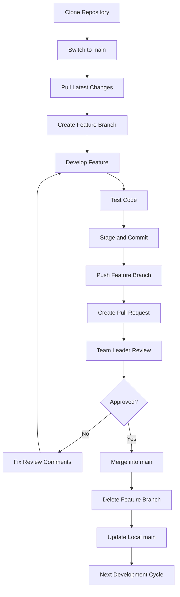

# Micro Social Blogging – Git Workflow Documentation

**Version:** 1.0  
**Version Control:** Git  
**Repository:** GitHub  
**Default Branch:** `main`  
**Team Size:** 3 Developers  
**Workflow:** Feature Branch Workflow with Pull Requests

---

## 1. Introduction

This document defines the Git workflow and collaboration standards for the ConnectX development team.

The workflow ensures:

- Independent development by each team member.
- Organized branch management.
- Controlled integration of code.
- Mandatory code reviews before merging.
- Consistent commit history.
- Safe collaboration without overwriting other developers' work.

All team members must follow these guidelines.

---

## 2. Team Roles and Responsibilities

| Role | Responsibilities |
|---|---|
| Developer 1 | Develop assigned features and submit Pull Requests |
| Developer 2 | Develop assigned features and submit Pull Requests |
| Developer 3 | Develop assigned features and submit Pull Requests |
| Team Leader | Review code, request changes, approve and merge Pull Requests |

### Developer Responsibilities

- Work on assigned feature branches.
- Pull the latest changes before starting development.
- Commit changes regularly.
- Push code to the respective remote branch.
- Create Pull Requests for completed features.
- Resolve review comments and merge conflicts.
- Never push directly to `main`.

### Team Leader Responsibilities

- Assign development tasks.
- Review Pull Requests.
- Verify functionality and code quality.
- Ensure project standards are followed.
- Approve or request changes.
- Merge approved Pull Requests into `main`.
- Maintain the stability of the main branch.

---

## 3. Branching Strategy

ConnectX follows a Feature Branch Workflow.

### Main Branches

| Branch | Purpose |
|---|---|
| `main` | Stable and reviewed code |
| `feature/*` | New feature development |
| `fix/*` | Bug fixes |
| `hotfix/*` | Urgent production fixes |
| `docs/*` | Documentation updates |

### Example Branch Structure

```text
main
 ├── feature/user-authentication
 ├── feature/post-management
 ├── feature/feed-system
 ├── fix/login-validation
 └── docs/api-documentation
```

### Branch Naming Convention

Format:

```text
<type>/<feature-name>
```

Examples:

```text
feature/user-authentication
feature/user-profile
feature/create-post
feature/like-system
feature/notification-system

fix/login-error
fix/profile-validation

docs/api-documentation
docs/git-workflow
```

**Rules:**

- Use lowercase letters.
- Separate words using hyphens.
- Use meaningful branch names.
- Avoid generic names such as `test`, `final`, or `my-branch`.

---

## 4. Initial Repository Setup

Every developer must configure Git and clone the project repository.

### Step 1: Install Git

Download Git from:

https://git-scm.com/downloads

Verify installation:

```bash
git --version
```

### Step 2: Configure Git Identity

```bash
git config --global user.name "Your Name"
git config --global user.email "your-email@example.com"
```

Verify configuration:

```bash
git config --global --list
```

### Step 3: Clone Repository

```bash
git clone https://github.com/PJain7988/Micro_Social_Blogging.git
```

### Step 4: Navigate to Project

```bash
cd Micro_Social_Blogging
```

### Step 5: Check Available Branches

```bash
git branch -a
```

### Step 6: Switch to Main

```bash
git switch main
```

### Step 7: Pull Latest Changes

```bash
git pull origin main
```

The local repository is now synchronized with GitHub.

---

## 5. Creating a Feature Branch

Each developer must create a separate branch for their assigned feature.

### Step 1: Update Main

```bash
git switch main
git pull origin main
```

### Step 2: Create Feature Branch

```bash
git switch -c feature/user-authentication
```

This command creates a new branch and switches to it.

### Step 3: Verify Current Branch

```bash
git branch
```

Example:

```text
  main
* feature/user-authentication
```

All changes related to user authentication must be made on this branch.

---

## 6. Daily Development Workflow

Every developer should follow the same development cycle.

### Step 1: Check Current Branch

```bash
git branch
```

### Step 2: Check Working Directory

```bash
git status
```

### Step 3: Review Code Changes

```bash
git diff
```

### Step 4: Stage Changes

Stage all intended changes:

```bash
git add .
```

Or stage a specific file:

```bash
git add backend/apps/accounts/views.py
```

### Step 5: Commit Changes

```bash
git commit -m "feat: implement user registration"
```

### Step 6: Push Changes

First push:

```bash
git push -u origin feature/user-authentication
```

Subsequent pushes:

```bash
git push
```

The changes are now available in the remote feature branch.

---

## 7. Commit Message Convention

All commits must follow a consistent naming format.

### Format

```text
<type>: <short description>
```

### Commit Types

| Type | Description |
|---|---|
| `feat` | New functionality |
| `fix` | Bug fixes |
| `docs` | Documentation changes |
| `refactor` | Code restructuring |
| `style` | Formatting and styling |
| `test` | Test-related changes |
| `chore` | Configuration and maintenance |
| `perf` | Performance improvements |

### Examples

```bash
git commit -m "feat: add user registration API"
git commit -m "feat: implement post creation"
git commit -m "fix: resolve login validation error"
git commit -m "docs: update API documentation"
git commit -m "test: add authentication tests"
git commit -m "refactor: improve user service"
```

### Commit Rules

- Use clear and meaningful messages.
- Keep commits focused on one logical change.
- Avoid committing unrelated files together.
- Never commit passwords, API keys or environment secrets.

---

## 8. Pull Request Workflow

A Pull Request (PR) is a request to merge changes from one branch into another.

Every completed feature must go through a Pull Request.

### Step 1: Push Feature Branch

```bash
git push origin feature/user-authentication
```

### Step 2: Open GitHub Repository

https://github.com/PJain7988/Micro_Social_Blogging

### Step 3: Create Pull Request

1. Open the Pull Requests section.
2. Select New Pull Request.
3. Choose the feature branch as the source.
4. Choose `main` as the target.
5. Review the changed files.
6. Add a meaningful title and description.
7. Submit the Pull Request.

### Pull Request Configuration

```text
Base Branch: main
Compare Branch: feature/user-authentication
```

### Recommended Pull Request Template

```markdown
## Summary
Describe the implemented feature.

## Features Implemented
- User registration API
- Password validation
- Duplicate email validation

## Files Changed
- accounts/views.py
- accounts/serializers.py
- accounts/urls.py

## Testing
- [ ] Functionality tested
- [ ] API responses verified
- [ ] Existing features tested

## Checklist
- [ ] Code follows project conventions
- [ ] No unnecessary files included
- [ ] No secrets committed
- [ ] Documentation updated if required
```

---

## 9. Code Review Process

The Team Leader must review every Pull Request before merging.

### Review Checklist

| Area | Verification |
|---|---|
| Functionality | Feature works according to requirements |
| Code Quality | Code is readable and maintainable |
| Validation | Input validation is implemented |
| Security | Authentication and authorization are correct |
| Database | Database operations are correct |
| API Contract | API follows the documented contract |
| Testing | Relevant tests pass |
| Integration | Existing functionality is not broken |
| Documentation | Required documentation is updated |

### Review Outcomes

| Status | Action |
|---|---|
| Approved | Pull Request can be merged |
| Changes Requested | Developer must fix identified issues |
| Commented | Reviewer has suggestions or questions |

### Handling Review Comments

After receiving review feedback:

```bash
git add .
git commit -m "fix: address review comments"
git push
```

The existing Pull Request will automatically include the new commits.

---

## 10. Merging into Main

Only the Team Leader or an authorized maintainer should merge approved Pull Requests.

### Before Merging

- Pull Request is approved.
- Required tests are passing.
- No unresolved review comments remain.
- No merge conflicts exist.
- Changes have been reviewed.
- Feature works with the latest main branch.

### Recommended Merge Method

**Squash and Merge**

Benefits:

- Maintains a clean main branch history.
- Combines multiple feature commits into one commit.
- Makes changes easier to track and revert.

After successful merging, the feature becomes part of `main`.

---

## 11. Synchronizing with Main

Other developers may merge changes while a developer is working on a feature.

Developers must regularly synchronize their feature branches with the latest `main`.

### Step 1: Fetch Latest Changes

```bash
git fetch origin
```

### Step 2: Switch to Feature Branch

```bash
git switch feature/user-authentication
```

### Step 3: Merge Latest Main

```bash
git merge origin/main
```

### Step 4: Resolve Conflicts if Required

After resolving conflicts:

```bash
git add .
git commit
```

### Step 5: Push Updated Branch

```bash
git push
```

**Important:** Always review incoming changes before merging. Do not blindly overwrite your feature branch.

---

## 12. Merge Conflict Resolution

A merge conflict occurs when Git cannot automatically combine changes made to the same part of a file.

### Example Conflict

```python
<<<<<<< HEAD
def login():
    return "Login implementation A"
=======
def login():
    return "Login implementation B"
>>>>>>> origin/main
```

### Resolution Process

1. Open the conflicted file.
2. Review both implementations.
3. Discuss with the other developer if required.
4. Keep the correct implementation.
5. Remove conflict markers.
6. Save the file.
7. Test the affected functionality.

### Complete the Merge

```bash
git status
git add .
git commit
```

Then push:

```bash
git push
```

### Conflict Resolution Rules

- Never delete another developer's code without understanding it.
- Never accept one side blindly.
- Coordinate when shared files are involved.
- Test the final combined implementation.
- Ask the Team Leader for help when necessary.

---

## 13. Team Collaboration Scenarios

### Scenario A: Different Developers Working on Different Features

```text
Developer 1:
feature/user-authentication

Developer 2:
feature/post-management

Developer 3:
feature/notification-system
```

Each developer works independently.

All three features are submitted through separate Pull Requests and merged into `main` after approval.

### Scenario B: Multiple Developers Editing the Same File

If two developers need to modify the same file:

1. Discuss the changes before editing.
2. Divide responsibilities where possible.
3. Avoid unnecessary overlapping changes.
4. Synchronize with the latest main branch.
5. Resolve conflicts carefully.
6. Test the final implementation.

### Scenario C: Fixing an Existing Bug

Create a dedicated fix branch:

```bash
git switch main
git pull origin main
git switch -c fix/login-validation
```

Implement the fix, test it and submit a Pull Request.

### Scenario D: Urgent Production Bug

Create a hotfix branch:

```bash
git switch main
git pull origin main
git switch -c hotfix/critical-auth-error
```

Fix the issue and submit a high-priority Pull Request.

---

## 14. Main Branch Protection

The `main` branch should be protected through GitHub repository settings.

### Recommended Settings

| Setting | Configuration |
|---|---|
| Require Pull Request | Enabled |
| Required approvals | At least 1 |
| Require status checks | Enabled when CI is configured |
| Require conversation resolution | Enabled |
| Restrict direct pushes | Enabled |
| Force pushes | Disabled |

### Configuration Steps

1. Open the GitHub repository.
2. Navigate to Settings.
3. Open Rules → Rulesets or Branch protection rules.
4. Create a rule for `main`.
5. Enable Pull Request requirements.
6. Configure approvals and status checks.
7. Restrict direct pushes.
8. Save the configuration.

Available settings may vary according to GitHub plan and repository permissions.

---

## 15. Useful Git Commands

| Command | Purpose |
|---|---|
| `git init` | Initialize repository |
| `git clone <url>` | Clone repository |
| `git status` | Check working directory |
| `git branch` | List local branches |
| `git branch -a` | List all branches |
| `git switch main` | Switch to main |
| `git switch -c feature/name` | Create feature branch |
| `git fetch origin` | Fetch remote changes |
| `git pull origin main` | Pull main changes |
| `git add .` | Stage changes |
| `git commit -m "message"` | Create commit |
| `git push` | Push current branch |
| `git diff` | Review changes |
| `git log --oneline` | View commit history |
| `git merge origin/main` | Merge latest main |
| `git stash` | Temporarily save changes |
| `git stash pop` | Restore stashed changes |
| `git restore <file>` | Discard unstaged file changes |
| `git switch -` | Switch to previous branch |

---

## 16. Git Stash

Git stash temporarily saves uncommitted changes so developers can switch branches without committing incomplete work.

### Save Changes

```bash
git stash
```

### View Stashed Changes

```bash
git stash list
```

### Restore Latest Stash

```bash
git stash pop
```

### Restore Without Removing Stash

```bash
git stash apply
```

Stash is intended for temporary work, not permanent backup.

---

## 17. Deleting Merged Branches

After a Pull Request is merged, completed feature branches can be deleted.

### Delete Local Branch

```bash
git switch main
git pull origin main
git branch -d feature/user-authentication
```

### Delete Remote Branch

```bash
git push origin --delete feature/user-authentication
```

Never delete a branch containing unmerged work.

---

## 18. Git Ignore and Sensitive Files

The following files and folders should generally not be committed:

```text
.env
.env.local
.env.production
node_modules/
venv/
__pycache__/
.pytest_cache/
dist/
build/
coverage/
```

### Example `.gitignore`

```gitignore
# Environment variables
.env
.env.*
!.env.example

# Node.js
node_modules/
dist/
coverage/

# Python
__pycache__/
*.py[cod]
venv/

# Build files
build/

# Editors
.vscode/
.idea/

# Operating system
.DS_Store
Thumbs.db
```

### Sensitive Information Rules

Never commit:

- Database passwords.
- JWT secrets.
- Cloudinary credentials.
- Gemini API keys.
- Production credentials.

If a secret is accidentally committed, rotate the exposed credential immediately and remove the secret from repository history where necessary.

---

## 19. Daily Development Routine

### Before Starting Work

```bash
git switch main
git pull origin main
git switch -c feature/your-feature
```

If the feature branch already exists, switch to it instead of creating it again.

### During Development

```bash
git status
git diff
git add .
git commit -m "feat: implement assigned feature"
git push
```

### Before Creating Pull Request

- Verify functionality.
- Run relevant tests.
- Review changed files.
- Update documentation when required.
- Push the latest changes.

### After Pull Request Approval

- Team Leader merges the Pull Request.
- Developer updates local `main`.
- Completed feature branch is deleted when appropriate.

---

## 20. Complete Git Workflow Diagram



---

## 21. Golden Rules

1. Never work directly on `main`.
2. Every feature must have its own branch.
3. Pull the latest `main` before starting development.
4. Commit changes regularly.
5. Use meaningful commit messages.
6. Never commit secrets or environment files.
7. Create a Pull Request for every feature.
8. Every Pull Request must be reviewed.
9. Only authorized maintainers can merge into `main`.
10. Resolve conflicts carefully.
11. Test code before submitting a Pull Request.
12. Do not force-push shared branches without team approval.
13. Keep documentation updated.
14. Communicate before modifying shared files or common functionality.

---

## 22. Workflow Summary

| Stage | Responsible | Action |
|---|---|---|
| Repository setup | All developers | Clone repository |
| Task assignment | Team Leader | Assign features |
| Branch creation | Developer | Create feature branch |
| Development | Developer | Implement feature |
| Testing | Developer | Verify functionality |
| Commit and push | Developer | Upload changes |
| Pull Request | Developer | Request review |
| Code review | Team Leader | Review implementation |
| Issue resolution | Developer | Fix review comments |
| Merge | Team Leader | Merge into main |
| Synchronization | All developers | Pull latest main |

---

**End of Git Workflow Documentation**
