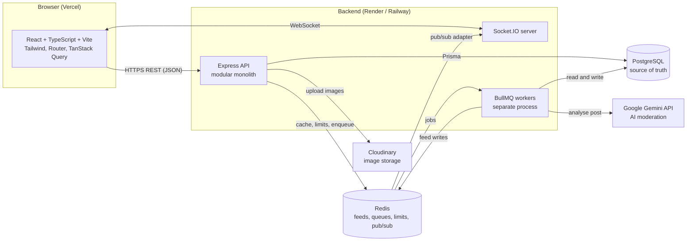
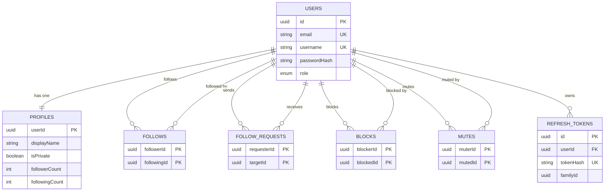
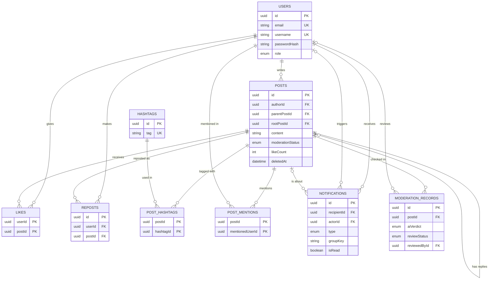
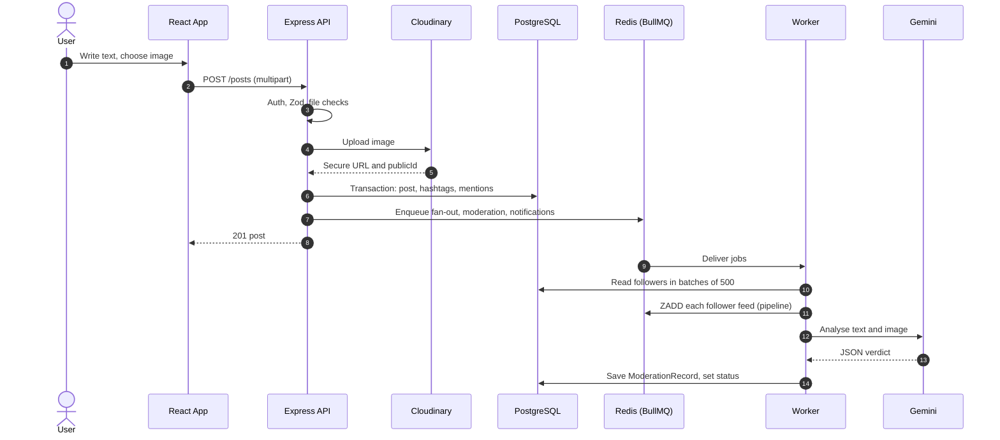
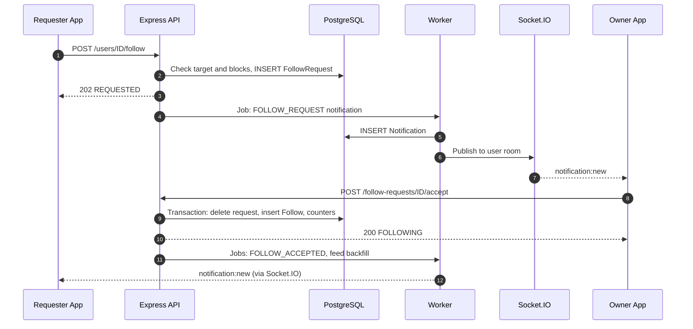
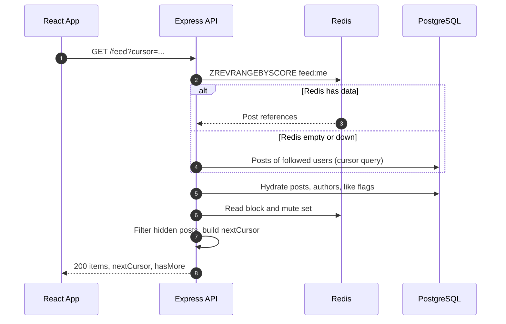

# ConnectX – Software Requirements Specification

<!--pdf:skip-->
| | |
|---|---|
| **Project** | ConnectX – Micro-blogging Social Network |
| **Document** | Software Requirements Specification (SRS), Version 1.0 |
| **Date** | 3 November 2026 |
| **Type** | College-level, individual full-stack project |
<!-- | **Prepared by** | [Your Name] · [Roll No.] · [Institution] | -->

**Contents:** 1 Introduction · 2 Technology Stack · 3 Functional Requirements · 4 System Architecture · 5 Database Design · 6 Technical Workflows · 7 Redis and Background Processing · 8 Real-Time Communication · 9 AI Content Moderation · 10 API Documentation · 11 Security · 12 UI/UX · 13 Non-Functional Requirements · 14 Day-wise Plan · 15 Testing · 16 Deployment · 17 Assumptions and Future Scope · Appendix A Quality Verification · Appendix B Detailed API Examples
<!--pdf:end-->

## 1. Introduction

### 1.1 Purpose
This document defines what ConnectX must do and how it will be built. It is written for a student developer, project evaluators and testers. It is detailed enough to start full-stack coding, create the database, implement the APIs, write tests and answer viva questions. All API contracts in this document are **proposed designs, not implemented APIs**.

### 1.2 Problem Statement
Develop a modern micro-blogging social network where users can create accounts, publish text and image posts, follow other users, interact through likes and reposts, reply to posts, explore trending hashtags and receive real-time notifications. The system must provide a personalized and fast home feed, secure authentication, private accounts, AI-powered content moderation and efficient data management. It must stay responsive and keep data consistent when many users act at the same time. ConnectX is inspired by the core ideas of X (Twitter) and Threads, but it is an original application with its own branding.

### 1.3 Scope
**In scope:** the 22 functional modules in Section 3, a React web client, a Node.js API, background workers, real-time updates, an admin moderation dashboard, deployment and testing. **Out of scope:** see Section 17 (no direct messaging, no native apps, no payments).

### 1.4 Key Terms
<!--cols:18,82-->
| Term | Simple meaning |
|---|---|
| Feed | The list of posts a user sees on the home page, newest first. |
| Fan-out-on-write | When someone posts, the system immediately copies a reference to that post into every follower's feed list (in Redis), so reading the feed is very fast. |
| Cursor pagination | Loading a long list in pages by saying "give me the next 20 items after this marker" instead of "page number 5". It never repeats or skips items when new data arrives. |
| JWT / refresh token | A short-lived signed "ID card" (access token, 15 min) used on every request, and a longer-lived secret (refresh token, 7 days) used only to get a new ID card. |
| Queue / worker | A queue is a to-do list stored in Redis (BullMQ). A worker is a program that takes jobs from the list and does them in the background. |
| Socket.IO room | A named group of connected browsers. The server sends one message to the room and every member receives it. |
| Source of truth | The one place whose data is always correct. In ConnectX this is PostgreSQL; Redis only holds copies that can be rebuilt. |

## 2. Technology Stack
Every technology below is used consistently throughout this document.
<!--cols:13,19,68-->
| Layer | Technology | Purpose in simple language |
|---|---|---|
| Frontend | React.js | Builds the user interface from reusable components (post card, composer, profile header). |
| Frontend | TypeScript | JavaScript with types, so many mistakes are caught before the app runs. Used in both frontend and backend. |
| Frontend | Vite | Fast development server and production bundler for the React app. |
| Frontend | Tailwind CSS | Utility classes for fast, consistent, responsive styling and dark mode. |
| Frontend | React Router | Moves between pages (Home, Profile, Explore) without reloading the browser. |
| Frontend | TanStack Query | Fetches API data, caches it, handles loading/error states, infinite scroll and optimistic updates. |
| Backend | Node.js + Express.js | Runs the JavaScript server and defines REST API routes and middleware. |
| Backend | Prisma ORM | Type-safe database access and migrations; protects against SQL injection by using parameters. |
| Backend | Zod | Checks that incoming data (body, query, params) has the correct shape before it is used. |
| Data | MongoDB | Main non-relational database. Stores all permanent data (source of truth). |
| Data | Redis | Very fast in-memory store for feeds, counters, rate limits, queues and real-time messaging. |
| Infra | Docker | Runs MongoDB and Redis (and optionally the apps) identically on every computer. |
| Infra | BullMQ | Job queue on top of Redis for background work: fan-out, notifications, moderation, trending. |
| Infra | Socket.IO | Two-way real-time connection for live counts and instant notifications. |
| External | Cloudinary | Stores and serves uploaded images (avatars, post images) through a CDN. |
| External | Google Gemini API | AI model that reads new posts and reports whether they may break community rules. |
| Deployment | Vercel | Hosts the built React app. |
| Deployment | Render or Railway | Hosts the Express API and the worker process. |
| Deployment | Managed MongoDB / Redis | Hosted databases with backups, so no server maintenance is needed. |
| Supporting | bcrypt, jsonwebtoken, Helmet, cors, Multer, Pino, Vitest, Supertest, Playwright | Password hashing, tokens, secure headers, cross-origin rules, file uploads, logging, unit/integration tests, end-to-end tests. |

## 3. Functional Requirements
Each requirement is mandatory ("shall"). The same IDs are used in tests and in the day-wise plan.
<!--cols:6,15,79-->
| ID | Feature | Purpose and expected behavior |
|---|---|---|
| FR-01 | Registration and login | Users create an account with email, unique username (3–20 letters, digits, underscore) and password (min 8 chars, letter and number). Passwords are hashed. Login returns a 15-minute access token and sets a 7-day refresh cookie. Logout revokes the refresh token. |
| FR-02 | Profile and avatar | Each user has a profile: display name (≤50), bio (≤160), avatar (JPEG/PNG/WebP, ≤2 MB), privacy switch and live follower/following counts. Username can be changed if still unique. |
| FR-03 | Create, edit, delete posts | Post text ≤280 characters, optional image; text or image is required. Editing marks the post "edited", re-parses hashtags/mentions and re-runs moderation. Delete is a soft delete (author or admin); the post leaves feeds and replies show "This post was deleted". |
| FR-04 | Image uploads | One image per post (JPEG/PNG/WebP, ≤5 MB). Type, size and file signature are verified on the server before the image is sent to Cloudinary. Only the secure URL and public ID are stored. |
| FR-05 | Threaded replies | A reply targets a post or another reply (`parentPostId`) and stores `rootPostId` for fast thread loading. Replies appear in the thread view and the profile Replies tab, not in the home feed. Parent reply count is updated. |
| FR-06 | Follow / unfollow | A user can follow any other user (not self, not blocked). Public accounts are followed instantly; private accounts create a follow request. Operations are idempotent. |
| FR-07 | Follower / following counts | Counts are stored on the profile and changed in the same database transaction as the follow row, so they always match. Lists are paginated. |
| FR-08 | Personalized home feed | Shows posts and reposts from followed users plus own posts, newest first, 20 per page. Hides deleted, flagged, rejected, blocked and muted content. |
| FR-09 | Cursor-based pagination | All lists (feed, replies, notifications, search, followers) use `limit` (default 20, max 50) and an opaque `cursor` (encodes `createdAt` and `id`). Responses return `nextCursor` and `hasMore`. |
| FR-10 | Redis feed optimization | Each user has a Redis sorted set of up to 800 post references, filled by fan-out-on-write. If Redis is empty or down, the feed is built from PostgreSQL. |
| FR-11 | Likes and reposts | One like and one repost per user per post, toggled with idempotent calls. Counters change atomically. Private posts cannot be reposted. Blocked users cannot interact. |
| FR-12 | Real-time updates | Socket.IO pushes live like/repost/reply counts to users viewing a post and new notifications to the recipient. |
| FR-13 | Hashtags and mentions | `#tag` (1–50 letters/digits/underscore, stored lowercase) and `@username` are parsed on the server. Tags link to a tag page; mentioned users get a notification. |
| FR-14 | Trending hashtags | Top 10 hashtags by number of public posts in the last 24 hours, refreshed every 5 minutes. |
| FR-15 | Private accounts and follow requests | Private users approve or decline followers. Only approved followers see their posts. Pending requests can be cancelled by the requester. |
| FR-16 | Real-time notifications | Types: like, repost, reply, mention, follow, follow request, request accepted, moderation. Stored in PostgreSQL and pushed live; unread badge and mark-as-read supported. |
| FR-17 | Grouped notifications | Similar events are shown as one item, for example "Asha and 4 others liked your post". Grouping uses `groupKey`. |
| FR-18 | AI content moderation | Gemini analyses each new or edited post in the background. Flagged posts are hidden until an admin decides. AI failures never block posting. |
| FR-19 | Admin moderation dashboard | Admin-only page with the review queue, AI categories and confidence, approve/reject with note, and basic statistics. |
| FR-20 | User and post search | Users by username/display name; posts by text. Results exclude blocked users, non-approved posts and private posts the viewer may not see. |
| FR-21 | Block and mute | Block removes follow relations both ways and hides everything between the two users. Mute only hides the muted user's posts and notifications from the muter. |
| FR-22 | API rate limiting | Redis-backed limits per IP/user: general 100 requests/min, login 5 attempts/15 min, post creation 30/hour, uploads 20/hour. Excess requests receive 429 with `Retry-After`. |

## 4. System Architecture

### 4.1 Modular Monolith
ConnectX is **one codebase and one deployable backend** divided into clear modules: `auth`, `users`, `posts`, `feed`, `social` (follow, block, mute), `notifications`, `moderation`, `search`, `admin`. Each module has its own routes, controller, service (business rules) and repository (Prisma queries) and talks to other modules only through service functions. This is easier to build and debug than microservices and can be split later. The same codebase starts two processes: the **API process** (Express + Socket.IO) and the **worker process** (BullMQ workers).



### 4.2 How the Components Communicate
<!--cols:26,22,52-->
| Connection | Protocol | What is exchanged |
|---|---|---|
| React → Express | HTTPS, JSON | All REST requests with `Authorization: Bearer <accessToken>`; refresh cookie only for `/auth/refresh`. |
| React ↔ Socket.IO | WebSocket (polling fallback) | Live counts and notifications. JWT is checked during the handshake. |
| Express → PostgreSQL | Prisma (TCP) | All permanent reads/writes, using transactions for multi-step changes. |
| Express → Redis | ioredis | Feed reads, block/mute sets, rate-limit counters, enqueueing jobs. |
| Express → Cloudinary | HTTPS (SDK) | Validated image streams in, secure URL and public ID out. |
| Workers → Redis / PostgreSQL | ioredis, Prisma | Take jobs, write feeds, save notifications and moderation results. |
| Workers → Gemini | HTTPS | Post text/image sent for analysis; structured JSON verdict returned. |
| Workers → Socket.IO | Redis pub/sub (Socket.IO Redis adapter and emitter) | Workers run in a different process, so they publish events through Redis and the API's Socket.IO servers deliver them. |

### 4.3 Request–Response Workflow
1. The user acts in the browser (for example clicks Like). A TanStack Query mutation updates the screen optimistically and sends the request.
2. Express runs the middleware chain: Helmet → CORS → request ID and logger → rate limiter → JWT authentication → role check → Zod validation.
3. The controller calls a service. The service applies business rules (privacy, block/mute, ownership).
4. The repository runs Prisma queries; multi-step changes use one transaction. PostgreSQL enforces unique keys, foreign keys and checks.
5. After the commit, the service may update Redis and enqueue BullMQ jobs; slow work never blocks the response.
6. The response is returned in the standard JSON envelope (Section 10). Errors pass through one central error handler.
7. TanStack Query stores the result (or rolls back the optimistic change on error), and React re-renders.
## 5. Database Design

### 5.1 Design Rules
- **Normalized (3NF):** each fact is stored once; many-to-many links use join tables (`Follows`, `Likes`, `PostHashtags`, ...).
- **Replies are posts.** The logical entity *Replies* is implemented as a self-reference on `Posts` (`parentPostId`). A reply therefore reuses likes, reposts, hashtags, mentions, notifications and moderation with no duplicated code.
- **Controlled denormalization:** `likeCount`, `repostCount`, `replyCount`, `followerCount`, `followingCount` are stored counters for speed. They change only inside the same transaction as the row that causes them, and a nightly job recalculates and corrects them.
- All IDs are UUIDs. Every table has `createdAt`. Posts use soft delete (`deletedAt`). Two supporting tables are added to the 14 required entities: `PostMentions` (needed for FR-13) and `RefreshTokens` (needed for secure refresh, FR-01).
- Referential integrity: every foreign key is enforced by PostgreSQL; child rows use `ON DELETE CASCADE` where the child has no meaning without the parent.

### 5.2 Relationships
<!--cols:18,82-->
| Type | Relationships |
|---|---|
| One-to-one | `Users` – `Profiles` (shared primary key `Profiles.userId`). |
| One-to-many | `Users`→`Posts`; `Posts`→`Posts` (replies); `Users`→`Notifications` (recipient); `Users`→`RefreshTokens`; `Posts`→`ModerationRecords`; `Posts`→`PostMentions`. |
| Many-to-many | `Users`↔`Users` through `Follows`, `FollowRequests`, `Blocks`, `Mutes`; `Users`↔`Posts` through `Likes` and `Reposts`; `Posts`↔`Hashtags` through `PostHashtags`; `Posts`↔`Users` (mentions) through `PostMentions`. |

### 5.3 Entity Details
Types: UUID, VARCHAR(n), TEXT, INT, BOOLEAN, TIMESTAMPTZ, JSONB. **PK** primary key, **FK** foreign key, **UQ** unique.
<!--cols:11,40,49-->
| Entity | Fields | Keys, constraints and important indexes |
|---|---|---|
| **Users** | `id` UUID; `email` VARCHAR(255); `username` VARCHAR(20); `passwordHash` VARCHAR(100); `role` ENUM(USER, ADMIN); `createdAt`, `updatedAt` TIMESTAMPTZ | PK `id`. UQ `email`, UQ `username` (lowercase). CHECK username format. |
| **Profiles** | `userId` UUID; `displayName` VARCHAR(50); `bio` VARCHAR(160); `avatarUrl` TEXT; `avatarPublicId` TEXT; `isPrivate` BOOLEAN; `followerCount`, `followingCount` INT | PK and FK `userId`→Users (CASCADE). CHECK counts ≥ 0. Trigram GIN index on `displayName` (search). |
| **Posts** (also Replies) | `id` UUID; `authorId` UUID; `content` VARCHAR(280); `imageUrl`, `imagePublicId` TEXT; `parentPostId`, `rootPostId` UUID NULL; `likeCount`, `repostCount`, `replyCount` INT; `moderationStatus` ENUM(PENDING, APPROVED, FLAGGED, REJECTED); `editedAt`, `deletedAt` NULL; `createdAt` | PK `id`. FK `authorId`→Users; FK `parentPostId`, `rootPostId`→Posts. CHECK content not empty or `imageUrl` present; counts ≥ 0. Indexes: (`authorId`,`createdAt` DESC,`id` DESC); (`parentPostId`,`createdAt`,`id`); (`rootPostId`); (`createdAt` DESC,`id` DESC); GIN full-text on `content`; partial index on `moderationStatus` = FLAGGED. |
| **Follows** | `followerId`, `followingId` UUID; `createdAt` | Composite PK (`followerId`,`followingId`) – prevents duplicates. FK both→Users. CHECK `followerId` ≠ `followingId`. Index (`followingId`,`createdAt` DESC) for follower lists and fan-out. |
| **FollowRequests** | `requesterId`, `targetId` UUID; `createdAt` | Composite PK (`requesterId`,`targetId`). FK both→Users. CHECK not self. A row exists only while pending; accept or reject deletes it. Index (`targetId`,`createdAt` DESC). |
| **Likes** | `userId`, `postId` UUID; `createdAt` | Composite PK (`userId`,`postId`) – one like per user per post. FK→Users, Posts (CASCADE). Index (`postId`,`createdAt`). |
| **Reposts** | `id` UUID; `userId`, `postId` UUID; `createdAt` | PK `id`. UQ (`userId`,`postId`). FK→Users, Posts. Index (`userId`,`createdAt` DESC) for profile Reposts tab. |
| **Hashtags** | `id` UUID; `tag` VARCHAR(50); `createdAt` | PK `id`. UQ `tag` (lowercase). |
| **PostHashtags** | `postId`, `hashtagId` UUID; `createdAt` (copy of post time) | Composite PK (`postId`,`hashtagId`). FK→Posts, Hashtags (CASCADE). Index (`hashtagId`,`createdAt` DESC) for tag pages; index (`createdAt`) for the 24-hour trending query. |
| **PostMentions** | `postId`, `mentionedUserId` UUID | Composite PK. FK→Posts, Users (CASCADE). Index (`mentionedUserId`). |
| **Notifications** | `id` UUID; `recipientId` UUID; `actorId` UUID NULL; `type` ENUM(LIKE, REPOST, REPLY, MENTION, FOLLOW, FOLLOW_REQUEST, FOLLOW_ACCEPTED, MODERATION); `postId` UUID NULL; `groupKey` VARCHAR(100); `isRead` BOOLEAN; `createdAt` | PK `id`. FK `recipientId`, `actorId`→Users; FK `postId`→Posts (CASCADE). UQ (`recipientId`,`actorId`,`type`,`postId`) with NULLS NOT DISTINCT (PostgreSQL 15+) stops duplicates. Indexes: (`recipientId`,`createdAt` DESC,`id` DESC); (`recipientId`,`isRead`); (`recipientId`,`groupKey`). |
| **Blocks** | `blockerId`, `blockedId` UUID; `createdAt` | Composite PK. FK both→Users (CASCADE). CHECK not self. Index (`blockedId`) to find who blocked a user. |
| **Mutes** | `muterId`, `mutedId` UUID; `createdAt` | Composite PK. FK both→Users (CASCADE). CHECK not self. |
| **ModerationRecords** | `id` UUID; `postId` UUID; `aiVerdict` ENUM(SAFE, FLAGGED, ERROR); `categories` JSONB; `confidence` NUMERIC(3,2); `aiReason` TEXT; `reviewStatus` ENUM(NOT_REQUIRED, PENDING_REVIEW, APPROVED, REJECTED); `reviewedById` UUID NULL; `reviewNote` VARCHAR(500); `reviewedAt` NULL; `createdAt` | PK `id`. FK `postId`→Posts (CASCADE); FK `reviewedById`→Users. Indexes: (`reviewStatus`,`createdAt`) for the admin queue; (`postId`,`createdAt` DESC). One new record per moderation run (new post or edit). |
| **RefreshTokens** | `id` UUID; `userId` UUID; `tokenHash` CHAR(64); `familyId` UUID; `expiresAt`, `revokedAt` NULL; `createdAt` | PK `id`. UQ `tokenHash` (SHA-256 of the token, never the token). FK `userId`→Users (CASCADE). Index (`userId`), (`familyId`). |

### 5.4 ER Diagram
The ER diagram is drawn in two parts so that it stays readable. Together they contain all 16 tables and every relationship; `Users` appears in both. Crow's-foot notation: `||` exactly one, `o{` zero or many, `|o` zero or one.

**Part A – accounts and social graph**


**Part B – content, interactions, notifications and moderation** (`USERS` repeated for context)


### 5.5 Representative Prisma Schema
Core entities are shown. `Block`, `Mute`, `PostMention` and `RefreshToken` follow the same pattern as `Follow` (composite key, two relations). Inverse relation fields are omitted for space; `prisma format` adds them. Full-text and trigram indexes and CHECK constraints are added in raw-SQL migrations because Prisma cannot express them.
```prisma
generator client {
  provider = "prisma-client-js"
}
datasource db {
  provider = "postgresql"
  url      = env("DATABASE_URL")
}
enum Role {
  USER
  ADMIN
}
enum ModerationStatus {
  PENDING
  APPROVED
  FLAGGED
  REJECTED
}
enum NotificationType {
  LIKE
  REPOST
  REPLY
  MENTION
  FOLLOW
  FOLLOW_REQUEST
  FOLLOW_ACCEPTED
  MODERATION
}
enum AiVerdict {
  SAFE
  FLAGGED
  ERROR
}
enum ReviewStatus {
  NOT_REQUIRED
  PENDING_REVIEW
  APPROVED
  REJECTED
}

model User {
  id           String   @id @default(uuid()) @db.Uuid
  email        String   @unique @db.VarChar(255)
  username     String   @unique @db.VarChar(20)
  passwordHash String
  role         Role     @default(USER)
  createdAt    DateTime @default(now())
  updatedAt    DateTime @updatedAt
  profile      Profile?
  posts        Post[]
}

model Profile {
  userId         String  @id @db.Uuid
  displayName    String  @db.VarChar(50)
  bio            String? @db.VarChar(160)
  avatarUrl      String?
  avatarPublicId String?
  isPrivate      Boolean @default(false)
  followerCount  Int     @default(0)
  followingCount Int     @default(0)
  user User @relation(fields: [userId], references: [id],
                      onDelete: Cascade)
}

model Post {
  id            String   @id @default(uuid()) @db.Uuid
  authorId      String   @db.Uuid
  content       String   @db.VarChar(280)
  imageUrl      String?
  imagePublicId String?
  parentPostId  String?  @db.Uuid
  rootPostId    String?  @db.Uuid
  likeCount     Int      @default(0)
  repostCount   Int      @default(0)
  replyCount    Int      @default(0)
  moderationStatus ModerationStatus @default(PENDING)
  editedAt      DateTime?
  deletedAt     DateTime?
  createdAt     DateTime @default(now())
  author  User   @relation(fields: [authorId], references: [id],
                           onDelete: Cascade)
  parent  Post?  @relation("Replies", fields: [parentPostId],
                           references: [id])
  replies Post[] @relation("Replies")
  @@index([authorId, createdAt(sort: Desc), id(sort: Desc)])
  @@index([parentPostId, createdAt, id])
  @@index([rootPostId])
  @@index([createdAt(sort: Desc), id(sort: Desc)])
}

model Follow {
  followerId  String   @db.Uuid
  followingId String   @db.Uuid
  createdAt   DateTime @default(now())
  follower  User @relation("Follower", fields: [followerId],
                           references: [id], onDelete: Cascade)
  following User @relation("Following", fields: [followingId],
                           references: [id], onDelete: Cascade)
  @@id([followerId, followingId])
  @@index([followingId, createdAt(sort: Desc)])
}

model FollowRequest {
  requesterId String   @db.Uuid
  targetId    String   @db.Uuid
  createdAt   DateTime @default(now())
  requester User @relation("Requester", fields: [requesterId],
                           references: [id], onDelete: Cascade)
  target    User @relation("Target", fields: [targetId],
                           references: [id], onDelete: Cascade)
  @@id([requesterId, targetId])
  @@index([targetId, createdAt(sort: Desc)])
}

model Like {
  userId    String   @db.Uuid
  postId    String   @db.Uuid
  createdAt DateTime @default(now())
  user User @relation(fields: [userId], references: [id],
                      onDelete: Cascade)
  post Post @relation(fields: [postId], references: [id],
                      onDelete: Cascade)
  @@id([userId, postId])
  @@index([postId, createdAt])
}

model Repost {
  id        String   @id @default(uuid()) @db.Uuid
  userId    String   @db.Uuid
  postId    String   @db.Uuid
  createdAt DateTime @default(now())
  user User @relation(fields: [userId], references: [id],
                      onDelete: Cascade)
  post Post @relation(fields: [postId], references: [id],
                      onDelete: Cascade)
  @@unique([userId, postId])
  @@index([userId, createdAt(sort: Desc)])
}

model Hashtag {
  id        String   @id @default(uuid()) @db.Uuid
  tag       String   @unique @db.VarChar(50)
  createdAt DateTime @default(now())
}

model PostHashtag {
  postId    String   @db.Uuid
  hashtagId String   @db.Uuid
  createdAt DateTime
  post    Post    @relation(fields: [postId], references: [id],
                            onDelete: Cascade)
  hashtag Hashtag @relation(fields: [hashtagId], references: [id],
                            onDelete: Cascade)
  @@id([postId, hashtagId])
  @@index([hashtagId, createdAt(sort: Desc)])
  @@index([createdAt])
}

model Notification {
  id          String           @id @default(uuid()) @db.Uuid
  recipientId String           @db.Uuid
  actorId     String?          @db.Uuid
  type        NotificationType
  postId      String?          @db.Uuid
  groupKey    String           @db.VarChar(100)
  isRead      Boolean          @default(false)
  createdAt   DateTime         @default(now())
  recipient User  @relation("Recipient", fields: [recipientId],
                            references: [id], onDelete: Cascade)
  actor     User? @relation("Actor", fields: [actorId],
                            references: [id], onDelete: Cascade)
  post      Post? @relation(fields: [postId], references: [id],
                            onDelete: Cascade)
  @@index([recipientId, createdAt(sort: Desc), id(sort: Desc)])
  @@index([recipientId, isRead])
  @@index([recipientId, groupKey])
}

model ModerationRecord {
  id           String       @id @default(uuid()) @db.Uuid
  postId       String       @db.Uuid
  aiVerdict    AiVerdict
  categories   Json?
  confidence   Decimal?     @db.Decimal(3, 2)
  aiReason     String?
  reviewStatus ReviewStatus @default(NOT_REQUIRED)
  reviewedById String?      @db.Uuid
  reviewNote   String?      @db.VarChar(500)
  reviewedAt   DateTime?
  createdAt    DateTime     @default(now())
  post     Post  @relation(fields: [postId], references: [id],
                           onDelete: Cascade)
  reviewer User? @relation(fields: [reviewedById],
                           references: [id])
  @@index([reviewStatus, createdAt])
  @@index([postId, createdAt(sort: Desc)])
}
```
## 6. Important Technical Workflows
Each row lists the frontend action and API request, then the backend steps (with database operations), Redis operations, the success response and the error handling. Steps are numbered in execution order. All paths start with `/api/v1`.

<!--cols:9,16,31,13,12,19-->
| Workflow | Frontend action and API | Backend processing and database operations | Redis | Response | Error handling |
|---|---|---|---|---|---|
| **W1 Register and login** | User submits form; Zod checks the fields in the browser. `POST /auth/register`, `POST /auth/login`, `POST /auth/refresh` | 1. Validate body. 2. Register: hash password (bcrypt, cost 12). 3. One transaction: INSERT `Users` + `Profiles`. 4. Login: find user by email, `bcrypt.compare`. 5. Create access JWT (15 min) and random refresh token; INSERT SHA-256 hash into `RefreshTokens`; send token as httpOnly cookie. 6. Refresh: look up hash, revoke it, issue a new one (rotation). | Login counter `rl:login:IP:email` | 201 or 200 `{user, accessToken}` + cookie | 400 validation; 409 email/username taken (unique constraint is the final guard); 401 "Invalid email or password" (same text for unknown email); 401 on reused refresh token → whole `familyId` revoked; 429 too many attempts. |
| **W2 Create post with image** | Composer checks type/size, shows preview and counter. `POST /posts` (multipart: `content`, `image`) | 1. Auth, Multer memory upload (max 5 MB). 2. Check MIME and file signature. 3. Zod: content ≤280. 4. Upload stream to Cloudinary → URL + publicId. 5. Parse `#tags`, `@mentions`. 6. Transaction: INSERT `Posts` (status PENDING), upsert `Hashtags`, INSERT `PostHashtags`, `PostMentions`. 7. Enqueue `feed-fanout`, `moderation`, `notifications` jobs (jobId includes postId). | BullMQ enqueue; `ZINCRBY ht:HOUR tag 1` | 201 `{post}` (returned before background work) | 400 invalid; 413 too large; 415 bad type; 502 Cloudinary down (nothing saved); if the DB transaction fails after upload, the uploaded image is deleted (compensation). |
| **W3 Follow user** | Follow button (optimistic). `POST /users/:id/follow` | 1. Target exists, not self, no block either way. 2. If target is public: transaction: INSERT `Follows` ON CONFLICT DO NOTHING; if inserted, `followerCount`+1 and `followingCount`+1. 3. Enqueue FOLLOW notification and a backfill job. 4. If target is private → W4. | Backfill: `ZADD feed:me` with target's latest 20 posts | 200 `{status:"FOLLOWING"}` | 400 self-follow; 403 blocked; 404 unknown user; repeat call is harmless (idempotent 200). |
| **W4 Private follow request** | Button shows "Requested". `POST /users/:id/follow` → `GET /follow-requests` → `POST /follow-requests/:userId/accept` or `/reject`; `DELETE /users/:id/follow-request` | 1. Target is private: INSERT `FollowRequests` (PK blocks duplicates); enqueue FOLLOW_REQUEST notification. 2. Accept: transaction: DELETE request, INSERT `Follows`, update both counters; enqueue FOLLOW_ACCEPTED + backfill. 3. Reject: DELETE request, no notification. 4. Cancel: requester deletes own request. | Backfill on accept | 202 `{status:"REQUESTED"}`; 200 on accept; 204 on reject/cancel | 404 no pending request; 403 caller is not the target; 409 already following. |
| **W5 Like / unlike** | Heart click (optimistic). `PUT /posts/:id/like`, `DELETE /posts/:id/like` | 1. Post visible to caller (not deleted, not blocked, private rule). 2. Like: transaction: INSERT `Likes`; on unique violation return current state; `likeCount`+1 (atomic `increment`). 3. Unlike: DELETE row; only if one row was deleted, `likeCount`−1. 4. After commit: enqueue LIKE notification (skip self-like); unlike removes it; emit `post:counts`. | Socket.IO publish to room `post:ID` | 200 `{liked, likeCount}` | 403/404 not visible; 429 limit; DB error → 500 and the client rolls back the optimistic change. |
| **W6 Reply and mentions** | Reply dialog. `POST /posts/:id/replies` | 1. Parent must exist, not deleted, visible. 2. Set `parentPostId`; `rootPostId` = parent's root or parent id. 3. Transaction: INSERT reply, parent `replyCount`+1, hashtags, mentions. 4. Enqueue REPLY notification (to parent author), MENTION notifications and `moderation` job. Replies are not fanned out to feeds. | Emit `post:counts` to root post room | 201 `{post}` | 404 parent deleted; 403 blocked; 400 invalid text. Mention of a user who blocked the author is silently skipped. |
| **W7 Load home feed** | `useInfiniteQuery` calls `GET /feed?cursor=&limit=20` when the user scrolls | 1. Decode cursor. 2. Read `limit`+10 references from Redis. 3. Hydrate: `SELECT ... WHERE id IN (...)` with author, profile, and the viewer's like/repost flags. 4. Remove deleted, FLAGGED/REJECTED, blocked/muted authors and private authors the viewer no longer follows; drop duplicate posts. 5. Build `nextCursor`. 6. Fallback: if Redis is empty or fails, query PostgreSQL for posts of followed users. | `ZREVRANGEBYSCORE feed:me`; `SISMEMBER blockmute:me` | 200 `{items, nextCursor, hasMore}` | 401 → refresh token once; 400 bad cursor; Redis error → silent fallback + warning log. |
| **W8 Fan-out-on-write** | None (background). Triggered by new post, new repost, accepted request. | Worker `feed-fanout`: 1. Load post; skip replies, deleted or rejected posts. 2. Read followers in batches of 500 (cursor on `Follows`). 3. One child job per batch. 4. Pipeline `ZADD feed:follower score=createdAt member=p:POSTID` (repost: member `r:REPOSTID`). 5. Add to author's own feed. 6. Trim each list to 800. On delete/reject: `ZREM` in batches. | `ZADD`, `ZREMRANGEBYRANK`, `ZREM`, `EXPIRE` 30 days | Job result (logged) | 5 attempts, exponential backoff from 2 s; job is idempotent (`ZADD` of the same member only updates the score); final failure is kept in the failed set; the PostgreSQL fallback hides any gap. |
| **W9 Real-time notification** | Socket receives `notification:new` or `notification:updated`; badge and list update. `GET /notifications`, `POST /notifications/read` | Worker `notifications`: 1. Skip if actor = recipient, blocked, or muted. 2. INSERT `Notifications` (unique key prevents duplicates). 3. Compute grouped summary for `groupKey` (count + latest 3 actors). 4. Publish to room `user:RECIPIENT`. | Pub/sub via Socket.IO adapter; `INCR notif:unread:ID` | Socket payload `{groupKey, type, count, actors, postId, createdAt}` | Offline user reads from REST on next load; 3 attempts; socket failure never rolls back the saved notification. |
| **W10 Trending hashtags** | Explore page and sidebar call `GET /hashtags/trending`; refetch every 60 s | 1. After each post commit, `ZINCRBY` the hourly bucket of each tag (public accounts only). 2. Repeatable job every 5 min: `ZUNIONSTORE trending:24h` over the last 24 hourly keys, keep top 10, cache JSON for 10 min. 3. On delete/reject, decrement the post's bucket. 4. Nightly reconcile with SQL: `PostHashtags` joined to public, non-rejected `Posts` where `createdAt` > now() − 24 h, `GROUP BY tag ORDER BY count DESC LIMIT 10`. | `ht:YYYYMMDDHH` (TTL 26 h), `trending:24h`, `trending:top` | 200 `{items:[{tag, postCount}]}` | Redis down → run the SQL query live; no data → empty list. |
| **W11 AI moderation** | Author sees the post at once; flagged author sees "under review". Admin uses dashboard. | Worker `moderation`: 1. Load text and image. 2. Call Gemini with a fixed prompt and JSON schema (timeout 15 s). 3. Validate JSON with Zod. 4. INSERT `ModerationRecords`. 5. SAFE: set post APPROVED. Flagged (confidence ≥ 0.70): set post FLAGGED, `reviewStatus` PENDING_REVIEW, `ZREM` from feeds. 6. Admin approve/reject (Section 9). | `ZREM` on flag | Admin: 200 `{moderationStatus}` | See Section 9.5: retries, then ERROR record and manual review; invalid JSON counts as failure. |
| **W12 Block and mute** | Profile menu → confirm. `PUT /users/:id/block`, `DELETE /users/:id/block`, `PUT /users/:id/mute`, `DELETE /users/:id/mute` | 1. Block: transaction: INSERT `Blocks`; DELETE `Follows` both directions and fix four counters; DELETE `FollowRequests` both directions. 2. Mute: INSERT `Mutes` only. 3. Every read path (profile, posts, feed, search, replies, notifications) applies the block/mute rules from one shared visibility service. | `DEL blockmute:A` and `blockmute:B`; rebuilt from PostgreSQL on next read | 200 `{blocked:true}` / `{muted:true}` | 400 self; 404 unknown user; repeat call is idempotent. |

### 6.1 Sequence Diagrams
**Create a post (W2, W8, W11)**

**Follow a private account (W4, W9)**

**Load the home feed (W7)**


## 7. Redis and Background Processing
**Rule: PostgreSQL is the permanent source of truth.** Everything in Redis is a copy or a temporary value that can be deleted and rebuilt without losing user data.

### 7.1 Redis Data Structures
<!--cols:21,10,40,29-->
| Key | Type | Content | Limit / expiry |
|---|---|---|---|
| `feed:USERID` | Sorted set | Members `p:POSTID` or `r:REPOSTID`, score = time in ms | Max 800 items; TTL 30 days (rebuilt on demand) |
| `blockmute:USERID` | Set | IDs the user blocked or muted, plus IDs that blocked the user | Rebuilt from PostgreSQL after any change |
| `ht:YYYYMMDDHH` | Sorted set | Hashtag → posts in that hour | TTL 26 hours |
| `trending:24h`, `trending:top` | Sorted set, string | Merged 24-hour scores; cached top-10 JSON | Rewritten every 5 min; JSON TTL 10 min |
| `notif:unread:USERID` | String (counter) | Unread notification count | Corrected from PostgreSQL when read |
| `rl:SCOPE:KEY` | String (counter) | Rate-limit counter | TTL = window length |
| `bull:*` | BullMQ keys | Queues, jobs, retry and failed sets | Completed jobs kept 1 day or 1,000 items |
| Socket.IO channels | Pub/Sub | Cross-process event delivery | None (not stored) |

### 7.2 BullMQ Queues and Workers
<!--cols:15,25,16,20,24-->
| Queue | Job and trigger | Attempts / backoff | Duplicate prevention | After final failure |
|---|---|---|---|---|
| `feed-fanout` | Fan-out or backfill; new post, repost, accepted request | 5 / exponential, 2 s base | `jobId = fanout:POSTID`; batch jobs `fanout:POSTID:n` | Kept in failed set, error log; feed fallback covers the gap |
| `notifications` | Create and publish a notification | 3 / exponential, 1 s | Database unique key + `jobId = notif:TYPE:ACTOR:POST` | Failed set; user still sees it later via REST if row exists |
| `moderation` | Gemini analysis of new or edited post | 4 / exponential, 5 s | `jobId = mod:POSTID:VERSION` | ERROR record, post goes to manual review queue |
| `trending` | Repeatable job, every 5 minutes | 2 / fixed 10 s | Repeat key (one schedule only) | Old cached top-10 stays; SQL fallback on read |
| `maintenance` | Nightly counter reconciliation, expired refresh-token purge, orphan Cloudinary cleanup; every 5 min re-queue of posts stuck in PENDING without a record | 3 / exponential | Repeat key | Alert in log |

### 7.3 Cache Invalidation, Retries and Redis Failure
- **Invalidation:** post delete/reject → `ZREM` from follower feeds (read-time filtering already hides it); unfollow → remove that author's items from the user's feed; block/mute change → delete both `blockmute` sets; new follow → backfill 20 recent posts; privacy change → feeds are filtered again at read time, so no purge is needed.
- **Retries:** workers are idempotent (safe to run twice). Backoff is exponential with jitter. A job that fails its last attempt is moved to the failed set and logged with the job ID, so it can be inspected and retried manually.
- **Redis failure fallback:** feed → PostgreSQL query; trending → SQL query; rate limiter → per-instance in-memory limiter (stricter); notifications → saved in PostgreSQL and fetched by REST; Socket.IO → clients poll `GET /notifications/unread-count` every 60 s. Posts, likes and follows still work because they only need PostgreSQL. When Redis returns, the maintenance job re-queues posts that missed moderation, and feeds are rebuilt lazily.
- **Memory safety:** Redis runs with `maxmemory-policy noeviction` (required by BullMQ); feed lists are capped, and every cache key has a TTL.

## 8. Real-Time Communication
Socket.IO runs on the same HTTP server as Express. The browser connects after login and sends the access token in the handshake (`auth: {token}`).
<!--cols:22,12,18,48-->
| Event | Direction | Room | Payload and rule |
|---|---|---|---|
| `post:join`, `post:leave` | Client → server | – | `{postId}`. Server joins room `post:ID` only if the viewer may see the post (private, block and deleted checks). Max 20 post rooms per socket. |
| `post:counts` | Server → client | `post:ID` | `{postId, likeCount, repostCount, replyCount}` after a like, repost or reply (live counts). |
| `notification:new` | Server → client | `user:ID` | A new or grouped notification item. |
| `notification:updated` | Server → client | `user:ID` | Updated group count (e.g. "and 5 others") and new unread total. |
| `notification:read` | Server → client | `user:ID` | Keeps several open tabs in sync after mark-as-read. |

- **Connect:** the server verifies the JWT, stores `socket.data.userId`, and joins `user:USERID`. Invalid or expired token → `connect_error` with code `UNAUTHORIZED`; the client refreshes the token once and reconnects.
- **Disconnect:** nothing is saved about the connection. Socket.IO reconnects automatically with backoff; after reconnecting, the client refetches the unread count and the open post through REST, so missed events are not lost.
- **Authorization:** clients may only send `post:join` and `post:leave`. All other events are server-originated, so one user cannot push data to another. Payloads carry IDs and counts only, never private text.
- **Scaling:** the Socket.IO Redis adapter lets several API instances and the worker process publish to the same rooms.

## 9. AI Content Moderation
### 9.1 Workflow
1. A new or edited post is saved with `moderationStatus = PENDING` and is visible immediately (publish first, review after, so users do not wait for the AI).
2. A `moderation` job is queued. The worker sends the post text (and image, if any) to Gemini inside a fixed instruction prompt. The post is treated only as data to analyse, never as instructions.
3. Gemini must answer in a fixed JSON format. The worker validates it with Zod.
4. A `ModerationRecords` row is saved (verdict, categories, confidence, reason).
5. **SAFE** (all confidences < 0.70): post becomes `APPROVED`. **FLAGGED** (any category ≥ 0.70, threshold set by `MODERATION_THRESHOLD`): post becomes `FLAGGED`, disappears from feeds, search and trending, and enters the admin queue (`PENDING_REVIEW`). The author sees "Under review".
6. An admin opens the dashboard, reads the post with AI reasons and chooses **Approve** (post returns, status `APPROVED`) or **Reject** (post is soft-deleted, status `REJECTED`, author gets a MODERATION notification). The note, admin ID and time are saved.

### 9.2 AI Result (expected JSON)
```json
{ "verdict": "FLAGGED",
  "categories": { "hate": 0.12, "harassment": 0.91, "sexual": 0.01,
                  "violence": 0.05, "selfHarm": 0.00, "spam": 0.03 },
  "confidence": 0.91,
  "reason": "Direct personal insult aimed at another user." }
```
### 9.3 Moderation Status
<!--cols:16,32,26,26-->
| Status | Meaning | Visible to others? | Next step |
|---|---|---|---|
| PENDING | Saved, AI check not finished (or AI failed) | Yes | AI result, or admin review if AI failed |
| APPROVED | AI said safe, or admin approved | Yes | – |
| FLAGGED | AI suspects a rule break | No (author sees "Under review") | Admin approves or rejects |
| REJECTED | Admin confirmed a violation | No (soft-deleted) | Final |

### 9.4 Human Review and Accuracy
The AI can be wrong in both directions (false alarms and missed content). Therefore it **never deletes a post by itself**: the AI only hides a post temporarily, and only an admin can reject it. Admins can also re-run the AI check, and the threshold is configurable. Appeals are future scope.

### 9.5 AI Service Failure Handling
Timeouts, rate limits (429), 5xx errors or invalid JSON are retried 4 times with exponential backoff. After the last attempt, a record with `aiVerdict = ERROR` and `reviewStatus = PENDING_REVIEW` is created; the post stays `PENDING` and visible, and appears in the dashboard's "AI failed" tab for manual review. Posting never fails because of the AI service. A missing API key disables moderation with a clear log warning, and all posts go to manual review.
## 10. API Documentation
> **These are proposed API contracts, not implemented APIs.** They define what the backend should expose and may be refined during development.

### 10.1 Conventions
- **Base URL:** `/api/v1`. All bodies are JSON (`multipart/form-data` for uploads). Protected endpoints need `Authorization: Bearer ACCESS_TOKEN`. "Optional" means the endpoint works without login but hides content the viewer may not see.
- **Success format:** `{ "success": true, "data": { ... }, "meta": { "nextCursor": "string-or-null", "hasMore": true } }` (`meta` appears on lists only).
- **Error format:** `{ "success": false, "error": { "code": "VALIDATION_ERROR", "message": "Content must be 280 characters or fewer", "details": [ { "field": "content", "issue": "too_long" } ] } }`
- **Error codes:** 400 `VALIDATION_ERROR`, 401 `UNAUTHORIZED` / `TOKEN_EXPIRED`, 403 `FORBIDDEN`, 404 `NOT_FOUND`, 409 `CONFLICT`, 413 `FILE_TOO_LARGE`, 415 `UNSUPPORTED_MEDIA`, 429 `RATE_LIMITED`, 500 `INTERNAL_ERROR`, 502 `UPSTREAM_ERROR`. Lists take `?cursor=&limit=` (default 20, max 50). Examples below are shortened; `[ ]` means a list of objects. Every endpoint can also return 401 (when login is required) and 429.

### 10.2 Authentication APIs
<!--cols:21,12,9,22,23,13-->
| Method and URL | Purpose | Auth | Request body / params | Success response | Errors |
|---|---|---|---|---|---|
| `POST /auth/register` | Create account | No | `{"email":"asha@mail.com","username":"asha","password":"Passw0rd1","displayName":"Asha"}` | 201 `{user:{id,username},accessToken}` | 400, 409 |
| `POST /auth/login` | Sign in | No | `{"email":"asha@mail.com","password":"Passw0rd1"}` | 200 `{user,accessToken}` + refresh cookie | 401, 429 |
| `POST /auth/refresh` | Rotate refresh token, get new access token | Cookie | none | 200 `{accessToken}` | 401 (invalid or reused) |
| `POST /auth/logout` | Revoke refresh token | Yes | none | 204 | 401 |
| `GET /auth/me` | Current user and profile | Yes | none | 200 `{user,profile}` | 401 |

### 10.3 User and Profile APIs
<!--cols:21,12,9,22,23,13-->
| Method and URL | Purpose | Auth | Request body / params | Success response | Errors |
|---|---|---|---|---|---|
| `GET /users/:username` | Public profile | Optional | path `username` | 200 `{id,username,displayName,bio,avatarUrl,isPrivate,followerCount,followingCount,relationship:{following,requested,blocked,muted}}` | 404 (also when blocked) |
| `GET /users/:id/followers` | Follower list | Optional | `?cursor&limit` | 200 `[user]` + meta | 403 private, 404 |
| `GET /users/:id/following` | Following list | Optional | `?cursor&limit` | 200 `[user]` + meta | 403 private, 404 |
| `GET /users/:id/posts` | Profile posts | Optional | `?tab=posts` or `replies` or `reposts` | 200 `[post]` + meta | 403 private, 404 |
| `PATCH /profile` | Update own profile | Yes | `{"displayName":"Asha K","bio":"Dev","isPrivate":true,"username":"asha_k"}` | 200 `{profile}` | 400, 409 |
| `PUT /profile/avatar` | Upload avatar | Yes | multipart `avatar` (≤2 MB) | 200 `{avatarUrl}` | 413, 415, 502 |
| `DELETE /profile/avatar` | Remove avatar | Yes | none | 204 | 401 |

### 10.4 Post and Reply APIs
<!--cols:21,12,9,22,23,13-->
| Method and URL | Purpose | Auth | Request body / params | Success response | Errors |
|---|---|---|---|---|---|
| `POST /posts` | Create post | Yes | multipart `content`, optional `image` | 201 `{post:{id,content,imageUrl,author,likeCount,moderationStatus:"PENDING",createdAt}}` | 400, 413, 415, 502 |
| `GET /posts/:id` | Post details | Optional | path `id` | 200 `{post, viewer:{liked,reposted}}` | 403, 404 |
| `PATCH /posts/:id` | Edit own post | Yes (author) | `{"content":"Updated #node"}` | 200 `{post}` with `editedAt` | 400, 403, 404 |
| `DELETE /posts/:id` | Soft delete | Yes (author or admin) | none | 204 | 403, 404 |
| `POST /posts/:id/replies` | Reply to post or reply | Yes | `{"content":"Great point @ravi"}` or multipart with image | 201 `{post}` with `parentPostId`, `rootPostId` | 400, 403, 404 |
| `GET /posts/:id/replies` | Thread replies | Optional | `?cursor&limit` | 200 `[post]` + meta | 403, 404 |

### 10.5 Follow and Feed APIs
<!--cols:21,12,9,22,23,13-->
| Method and URL | Purpose | Auth | Request body / params | Success response | Errors |
|---|---|---|---|---|---|
| `POST /users/:id/follow` | Follow, or request if private | Yes | none | 200 `{status:"FOLLOWING"}` or 202 `{status:"REQUESTED"}` | 400, 403, 404 |
| `DELETE /users/:id/follow` | Unfollow | Yes | none | 204 | 404 |
| `DELETE /users/:id/follow-request` | Cancel own pending request | Yes | none | 204 | 404 |
| `GET /follow-requests` | Incoming pending requests | Yes | `?cursor&limit` | 200 `[{user,createdAt}]` + meta | 401 |
| `POST /follow-requests/:userId/accept` | Accept request | Yes | none | 200 `{status:"FOLLOWING"}` | 403, 404 |
| `POST /follow-requests/:userId/reject` | Reject request | Yes | none | 204 | 403, 404 |
| `GET /feed` | Personalized home feed | Yes | `?cursor&limit` | 200 `[{type:"post" or "repost",post,repostedBy}]` + meta | 400 (bad cursor) |

### 10.6 Like, Repost and Hashtag APIs
<!--cols:21,12,9,22,23,13-->
| Method and URL | Purpose | Auth | Request body / params | Success response | Errors |
|---|---|---|---|---|---|
| `PUT /posts/:id/like`, `DELETE /posts/:id/like` | Like or unlike | Yes | none | 200 `{liked:true,likeCount:12}` | 403, 404 |
| `PUT /posts/:id/repost`, `DELETE /posts/:id/repost` | Repost or undo | Yes | none | 200 `{reposted:true,repostCount:3}` | 403 (private/blocked), 404 |
| `GET /hashtags/trending` | Top 10 hashtags, last 24 h | Optional | none | 200 `[{tag:"nodejs",postCount:42}]` | – |
| `GET /hashtags/:tag/posts` | Posts with a hashtag | Optional | `?cursor&limit` | 200 `[post]` + meta (empty list if none) | 400 (bad tag) |

### 10.7 Notification, Search, Block and Mute APIs
<!--cols:21,12,9,22,23,13-->
| Method and URL | Purpose | Auth | Request body / params | Success response | Errors |
|---|---|---|---|---|---|
| `GET /notifications` | Grouped notifications | Yes | `?cursor&limit&unreadOnly` | 200 `[{groupKey,type,count,actors:[{username,avatarUrl}],postId,isRead,latestAt}]` + meta | 401 |
| `GET /notifications/unread-count` | Badge number | Yes | none | 200 `{count:3}` | 401 |
| `POST /notifications/read` | Mark as read | Yes | `{"groupKeys":["LIKE:abc"]}` or `{"all":true}` | 200 `{updated:4}` | 400 |
| `GET /search/users` | Find users | Optional | `?q=asha&cursor` (q ≥ 2 chars) | 200 `[user]` + meta | 400 |
| `GET /search/posts` | Find posts | Optional | `?q=node&cursor` | 200 `[post]` + meta | 400 |
| `PUT /users/:id/block`, `DELETE /users/:id/block` | Block or unblock | Yes | none | 200 `{blocked:true}` | 400, 404 |
| `PUT /users/:id/mute`, `DELETE /users/:id/mute` | Mute or unmute | Yes | none | 200 `{muted:true}` | 400, 404 |
| `GET /blocks`, `GET /mutes` | Lists for Settings | Yes | `?cursor&limit` | 200 `[user]` + meta | 401 |

### 10.8 Moderation APIs (Admin only, role `ADMIN`)
<!--cols:21,12,9,22,23,13-->
| Method and URL | Purpose | Auth | Request body / params | Success response | Errors |
|---|---|---|---|---|---|
| `GET /admin/moderation/queue` | Posts waiting for review | Admin | `?status=PENDING_REVIEW&cursor` | 200 `[{recordId,post,aiVerdict,categories,confidence,createdAt}]` + meta | 403 |
| `GET /admin/moderation/stats` | Dashboard numbers | Admin | none | 200 `{pendingReview,flaggedToday,approved,rejected,aiErrors}` | 403 |
| `POST /admin/moderation/:recordId/approve` | Approve flagged post | Admin | `{"note":"Context is fine"}` | 200 `{postId,moderationStatus:"APPROVED"}` | 403, 404, 409 (already reviewed) |
| `POST /admin/moderation/:recordId/reject` | Reject flagged post | Admin | `{"note":"Targeted harassment"}` | 200 `{postId,moderationStatus:"REJECTED"}` | 403, 404, 409 |
| `POST /admin/moderation/posts/:postId/recheck` | Re-run AI check | Admin | none | 202 `{queued:true}` | 403, 404 |

<!--pdf:skip-->
## Appendix B. Detailed API Examples (Markdown version only)
**POST /auth/register**
```json
// Request
{ "email": "asha@mail.com", "username": "asha", "password": "Passw0rd1", "displayName": "Asha" }
// 201 Created
{ "success": true, "data": { "user": { "id": "7c1e...", "username": "asha", "role": "USER" },
                             "accessToken": "eyJhbGciOi..." } }
```
**POST /posts** (multipart: `content` = "Learning #nodejs with @ravi", `image` = photo.png)
```json
// 201 Created
{ "success": true, "data": { "post": {
    "id": "b2f4...", "content": "Learning #nodejs with @ravi",
    "imageUrl": "https://res.cloudinary.com/.../photo.png",
    "author": { "id": "7c1e...", "username": "asha", "displayName": "Asha", "avatarUrl": null },
    "likeCount": 0, "repostCount": 0, "replyCount": 0,
    "moderationStatus": "PENDING", "createdAt": "2026-11-03T09:30:00.000Z" } } }
```
**GET /feed?limit=2**
```json
{ "success": true,
  "data": [ { "type": "post", "post": { "id": "b2f4...", "content": "..." } },
            { "type": "repost", "post": { "id": "a901..." },
              "repostedBy": { "username": "ravi" } } ],
  "meta": { "nextCursor": "MjAyNi0xMS0wM1QwOTozMDowMC4wMDBaX2IyZjQ", "hasMore": true } }
```
**GET /notifications** (grouped)
```json
{ "success": true,
  "data": [ { "groupKey": "LIKE:b2f4...", "type": "LIKE", "count": 5,
              "actors": [ { "username": "ravi" }, { "username": "meera" }, { "username": "kabir" } ],
              "postId": "b2f4...", "isRead": false, "latestAt": "2026-11-03T10:02:00.000Z" } ],
  "meta": { "nextCursor": null, "hasMore": false } }
```
**Error example – 403 on a private account's posts**
```json
{ "success": false, "error": { "code": "FORBIDDEN",
  "message": "This account is private. Send a follow request to see posts." } }
```
<!--pdf:end-->
## 11. Security Requirements
<!--cols:20,80-->
| Area | Requirement |
|---|---|
| Password hashing | bcrypt with cost 12 and automatic salt; plain passwords are never stored or logged. Minimum 8 characters with letter and number. |
| JWT authentication | Access token valid 15 minutes, signed with `JWT_ACCESS_SECRET` (HS256), held only in browser memory. Contains `sub` (user ID) and `role`. Expired tokens return `TOKEN_EXPIRED`. |
| Refresh token management | Random 256-bit token in an httpOnly, Secure, SameSite=None cookie (frontend and backend are on different domains) limited to `/auth/refresh`. Only its SHA-256 hash is stored. Rotation on every use; reuse of an old token revokes the entire token family. `/auth/refresh` also checks the `Origin` header against the allowed list (CSRF protection). Logout revokes the token. |
| Role-based authorization | Roles `USER` and `ADMIN` stored in `Users.role`. A `requireRole('ADMIN')` middleware protects `/admin/*`. Ownership checks protect edit and delete. The role is re-read from the database for admin actions. |
| Input validation | Zod schemas for every body, query and path parameter; unknown fields are rejected. Text is stored raw and escaped by React on output (no `dangerouslySetInnerHTML`). |
| API rate limiting | Redis-backed limits (FR-22) with stricter limits on login, registration, uploads and search. Returns 429 with `Retry-After`. |
| Secure image uploads | Whitelist JPEG/PNG/WebP; size limits (2 MB avatar, 5 MB post); verify magic bytes, not only the extension; files are never written to the server disk; Cloudinary folder and format restrictions; random public IDs. |
| CORS and Helmet | CORS allows only the Vercel frontend origin(s) with credentials; Helmet sets secure HTTP headers (HSTS, `X-Content-Type-Options`, frame protection); `x-powered-by` is removed. |
| Environment variables | Secrets (database URL, JWT secrets, Cloudinary and Gemini keys) live only in environment variables, validated by Zod at start-up; `.env` is in `.gitignore`; `.env.example` has no real values. |
| SQL injection prevention | Prisma uses parameterized queries. The few raw queries (search, trending) use `$queryRaw` with bound parameters only, never string concatenation. |
| Private account authorization | One shared `canViewPost` / `canViewProfile` service is used by every endpoint, search, hashtag page, Socket.IO room join and notification. Private content is returned only to the owner and approved followers. |
| Block and mute enforcement | Block: profile returns 404, no follow, like, repost, reply or mention; hidden from feed, search and notifications in both directions. Mute: hidden from the muter's feed and notifications only. Enforced on the server, never only in the UI. |
| Secure error handling | A central error handler returns the standard envelope. Stack traces and SQL errors are logged on the server but never sent to the client. Login errors do not reveal whether an email exists. |

## 12. UI/UX Requirements
The interface is modern, clean and responsive with an original brand (name ConnectX, own logo and colour palette). Light and dark themes use Tailwind `dark:` classes and follow the system setting, with a manual toggle saved in the browser. Layout: **mobile** (<640 px) single column with a bottom navigation bar; **tablet** icon sidebar; **desktop** three columns (navigation, feed, trends/search). Every list has loading skeletons, empty states and error messages with a retry button.
<!--cols:15,15,70-->
| Page | Route | Content and behavior |
|---|---|---|
| Landing | `/` | Short product pitch, sample posts, "Sign up" and "Log in" buttons; redirects to Home if already logged in. |
| Login | `/login` | Email, password, show/hide password, inline error messages, link to Register. |
| Registration | `/register` | Email, username (live availability check), display name, password with strength hint. |
| Home feed | `/home` | Post composer (counter, image preview) above an infinite-scroll feed; each post card has reply, repost, like, share; live counts; "N new posts" pill. |
| Explore | `/explore` | Search box with People and Posts tabs, top-10 trending hashtags, suggested users. |
| User profile | `/u/:username` | Avatar, bio, counts, Follow/Requested/Block/Mute menu; tabs Posts, Replies, Reposts; locked view for private accounts; own profile has Edit. |
| Post details | `/post/:id` | Main post, live counts, composer for replies, threaded replies (indentation up to 3 levels, then "Continue thread"). |
| Notifications | `/notifications` | Grouped items ("Asha and 4 others liked your post"), unread highlight, mark all read, live updates. |
| Follow requests | `/requests` | List with Accept and Decline buttons; empty state when none. |
| Settings | `/settings` | Edit profile and avatar, private-account switch, theme, blocked and muted lists, log out. |
| Admin dashboard | `/admin` | Admin only. Stat cards, tabs "Flagged" and "AI failed", post preview with AI categories and confidence, Approve/Reject with note. |

**Navigation:** a left sidebar (desktop) or bottom bar (mobile) links to Home, Explore, Notifications (with badge), Profile and Settings; Admin appears only for admins. Unauthenticated users can only open Landing, Login, Register and public profiles/posts.
**Navigation map:** Landing → Login or Register → Home feed. From Home: Explore, Notifications (→ Follow requests), Profile, Settings and Admin dashboard (admins only). Post cards open Post details; Explore and Notifications also open Post details and Profiles; Profile opens Post details.

**Key page workflows:** (1) Register → auto login → Home → follow suggested users → feed fills. (2) Home → write post → image preview → Post → post appears at top. (3) Notification click → opens post details with live counts. (4) Profile of private user → Follow → "Requested" → owner opens Follow requests → Accept → requester gets a notification.

## 13. Non-Functional Requirements
Targets are acceptance goals for a demo environment on free or small hosting plans (about 100 concurrent users) and are verified in Day 14.
<!--cols:6,15,79-->
| ID | Area | Requirement and measurable target |
|---|---|---|
| NFR-01 | Performance | p95 API response < 300 ms for reads and < 500 ms for writes (without image upload); first feed page < 400 ms with Redis and < 1.2 s on PostgreSQL fallback; image-post creation < 3 s on a normal connection. |
| NFR-02 | Performance | Background work: fan-out to 1,000 followers < 5 s; AI moderation result within 30 s for 95% of posts; notification delivery to an online user < 2 s. |
| NFR-03 | Scalability | Stateless API (several instances can run); fan-out in batches of 500; all lists use cursor pagination and indexes. Tested with 10,000 posts and 100 concurrent users; larger loads need further load testing (Section 17). |
| NFR-04 | Reliability | 99% monthly availability target (excluding free-tier cold starts); API keeps working when Redis or Gemini is down (fallbacks, Section 7.3); jobs retry automatically. |
| NFR-05 | Security | No critical or high `npm audit` findings at release; all rules of Section 11 covered by tests; 0 secrets in the repository. |
| NFR-06 | Maintainability | Strict TypeScript, ESLint and Prettier with no errors; modular folders; backend service-layer test coverage ≥ 70%; README with setup, environment variables and architecture. |
| NFR-07 | Usability | New user can register, post and follow someone within 3 minutes without help; clear validation messages; optimistic updates so likes feel instant (< 100 ms). |
| NFR-08 | Accessibility | WCAG 2.1 AA colour contrast in both themes; full keyboard use; labels and alt text; Lighthouse accessibility score ≥ 90. |
| NFR-09 | Database consistency | No duplicate likes, follows or reposts under 100 concurrent requests; stored counters equal real row counts (nightly check reports 0 differences); multi-step changes are transactions. |
| NFR-10 | Error handling | Every error uses the standard JSON format; no stack trace is visible to users; the UI shows a friendly message and a retry action. |
| NFR-11 | Logging | Structured JSON logs (Pino) with request ID, user ID, route, status and duration; failed jobs and moderation errors are logged; passwords, tokens and secrets are never logged. |

## 14. Day-wise Development Plan
The plan has exactly 15 days. Each day ends with working, tested and committed code.

**Day 1 – Repository setup, TypeScript, React, Express, PostgreSQL, Prisma and Redis**
- **Objective:** Create a running full-stack skeleton.
- **Backend:** Monorepo (`/client`, `/server`); strict TS config, ESLint, Prettier; Express app with Helmet, CORS, Pino, Zod-validated env, `/health`; Prisma and ioredis clients.
- **Frontend:** Vite + React + TS; Tailwind; React Router; TanStack Query provider; layout shell with dark-mode toggle.
- **Database:** `docker-compose` with PostgreSQL and Redis; first Prisma migration (`User`, `Profile`).
- **Testing:** Supertest test for `/health`; lint and type-check scripts pass.
- **Expected output:** Client and server run locally and connect to both databases. **End-of-day deliverable:** Git repository with README setup steps, tagged `day-1`.

**Day 2 – Authentication, registration, login, JWT and user profiles**
- **Objective:** Secure sign-up, sign-in and profiles (FR-01, FR-02).
- **Backend:** Register, login, refresh (rotation), logout, `/auth/me`; bcrypt; JWT and role middleware; auth rate limit; `PATCH /profile`; avatar upload to Cloudinary.
- **Frontend:** Login and Register pages; auth context with token refresh interceptor; protected routes; profile page and edit form.
- **Database:** Migrations for `RefreshTokens` and profile fields; seed script for an admin user.
- **Testing:** Hashing and JWT unit tests; integration tests for duplicate email, wrong password, expired token, refresh reuse (TC-01 to TC-06).
- **Expected output:** A user can register, log in, stay logged in, and edit the profile. **End-of-day deliverable:** Working auth flow and passing auth test suite.

**Day 3 – Post creation, image uploads and threaded replies**
- **Objective:** Create, view, edit and delete posts and replies (FR-03, FR-04, FR-05).
- **Backend:** Post CRUD with Zod; Multer + file-signature check + Cloudinary upload with compensation on failure; reply endpoints setting `parentPostId` and `rootPostId`.
- **Frontend:** Composer with counter and image preview; `PostCard`; post details page with threaded replies; edit/delete menu.
- **Database:** `Post` table with self-relation, CHECK constraints and indexes.
- **Testing:** Length limit, file type/size, ownership, soft delete and thread tests (TC-07 to TC-11).
- **Expected output:** Users publish text and image posts and discuss in threads. **End-of-day deliverable:** Posts and replies working end to end.

**Day 4 – Follow/unfollow system and follower/following counts**
- **Objective:** Social graph with correct counts (FR-06, FR-07).
- **Backend:** Follow/unfollow endpoints (idempotent), follower and following lists, counters updated in transactions, self-follow guard.
- **Frontend:** Follow button with optimistic update; followers/following lists; counts on profile.
- **Database:** `Follow` table, CHECK and indexes; counter fields.
- **Testing:** Idempotency; 50 parallel follows give 1 row and a count of 1 (TC-18); counts never negative.
- **Expected output:** Users follow and unfollow each other with exact counts. **End-of-day deliverable:** Social graph module with tests.

**Day 5 – Personalized home feed and cursor-based pagination**
- **Objective:** Feed built from PostgreSQL with stable pagination (FR-08, FR-09).
- **Backend:** Cursor encode/decode utility; `GET /feed` (own and followed users' posts); profile posts and replies with cursors.
- **Frontend:** Home feed with `useInfiniteQuery`, scroll trigger, skeletons and empty state.
- **Database:** Composite indexes; `EXPLAIN ANALYZE` check; seed script for 10,000 posts.
- **Testing:** No duplicates or gaps while new posts arrive (TC-14); invalid cursor returns 400; response-time check.
- **Expected output:** Smooth infinite scroll through a personalized feed. **End-of-day deliverable:** Feed API and page, with performance notes.

**Day 6 – Redis feed optimization and fan-out-on-write using BullMQ**
- **Objective:** Fast feed using Redis (FR-10).
- **Backend:** BullMQ queues and a separate worker entry point; `feed-fanout` job with batching, trim to 800 and retries; Redis-first feed read with PostgreSQL fallback; backfill on follow.
- **Frontend:** Feed unchanged apart from a "new posts" pill and error/retry state.
- **Database:** No schema change; verify indexes for the fallback query.
- **Testing:** ZSET content after posting (TC-12); Redis stopped → fallback (TC-13); retry and duplicate-job tests (TC-15).
- **Expected output:** Feed served from Redis; same result when Redis is down. **End-of-day deliverable:** Queue and worker setup documented in the README.

**Day 7 – Likes, reposts and real-time updates using Socket.IO**
- **Objective:** Interactions with live counts (FR-11, FR-12).
- **Backend:** Like and repost endpoints in transactions with atomic counters; Socket.IO with JWT handshake, rooms and `post:counts`; Redis adapter; repost fan-out.
- **Frontend:** Optimistic like/repost buttons; socket hook; live counts on feed and post pages.
- **Database:** `Like` and `Repost` tables with composite or unique keys.
- **Testing:** 100 parallel likes by one user give 1 row; 100 users give a count of 100 (TC-16, TC-17); socket without token is rejected (TC-23).
- **Expected output:** Counts update live in two browsers. **End-of-day deliverable:** Interaction and real-time modules with tests.

**Day 8 – Hashtags and mentions**
- **Objective:** Discoverable and connected content (FR-13).
- **Backend:** Parser utility (regex) with unit tests; upsert hashtags, `PostHashtags`, `PostMentions` in the post transaction; re-parse on edit; `GET /hashtags/:tag/posts`.
- **Frontend:** Hashtags and mentions rendered as links; tag page; basic @mention suggestions.
- **Database:** `Hashtag`, `PostHashtag`, `PostMention` with indexes.
- **Testing:** `#a_b`, duplicates, mixed case, e-mail addresses not treated as mentions, unknown user mention (TC-27).
- **Expected output:** Clicking a tag lists matching posts; mentions link to profiles. **End-of-day deliverable:** Hashtag and mention features.

**Day 9 – Trending hashtags and background jobs**
- **Objective:** Trending list for the last 24 hours (FR-14).
- **Backend:** Hourly Redis buckets, repeatable `trending` job every 5 min, `GET /hashtags/trending`, SQL fallback, nightly `maintenance` job (counter reconciliation).
- **Frontend:** Explore page and sidebar trending widget with auto-refresh.
- **Database:** Index on `PostHashtags.createdAt`; reconciliation SQL.
- **Testing:** 24-hour boundary with mocked time (TC-29); decrement on delete; fallback when Redis is down.
- **Expected output:** Correct top-10 list that changes as posts are added. **End-of-day deliverable:** Trending feature and scheduled jobs.

**Day 10 – Private accounts and follow requests**
- **Objective:** Privacy control (FR-15).
- **Backend:** `isPrivate` setting; central `canViewPost` and `canViewProfile` service applied to every read path; request, accept, reject, cancel endpoints; auto-accept pending requests when switching to public.
- **Frontend:** Privacy toggle; locked profile; "Requested" button; Follow requests page.
- **Database:** `FollowRequest` table and indexes.
- **Testing:** Privacy matrix (owner, approved follower, non-follower, anonymous, blocked) across profile, posts, search, tag page and direct URL (TC-19, TC-20).
- **Expected output:** Private posts are visible only to approved followers. **End-of-day deliverable:** Privacy module and passing privacy tests.

**Day 11 – Notifications and notification grouping**
- **Objective:** Live, grouped notifications (FR-16, FR-17).
- **Backend:** `notifications` worker for all event types; unique key; `groupKey` grouping query; unread count; mark read; Redis emitter to Socket.IO.
- **Frontend:** Notifications page with grouped text, bell badge, toast, mark-all-read.
- **Database:** `Notification` table and indexes.
- **Testing:** Grouping count, no self-notification, unlike removes item, muted/blocked suppression, delivery under 2 s (TC-24, TC-26).
- **Expected output:** Actions create live notifications that group correctly. **End-of-day deliverable:** Notification system.

**Day 12 – Gemini AI moderation and admin moderation dashboard**
- **Objective:** AI screening with human review (FR-18, FR-19).
- **Backend:** Gemini client with timeout; prompt and JSON schema; `moderation` worker, threshold, retries and ERROR handling; admin endpoints (queue, stats, approve, reject, recheck) with role guard.
- **Frontend:** Admin dashboard with queue, AI categories, confidence and decision form; "Under review" banner for authors.
- **Database:** `ModerationRecord` table; `moderationStatus` handling.
- **Testing:** Mocked Gemini for safe, flagged, malformed and timeout cases; non-admin gets 403 (TC-30 to TC-33).
- **Expected output:** Flagged posts are hidden and reviewable; AI outage never blocks posting. **End-of-day deliverable:** Moderation pipeline and dashboard.

**Day 13 – Search, block and mute functionality**
- **Objective:** Discovery and personal safety tools (FR-20, FR-21).
- **Backend:** User search (trigram) and post search (full-text) with bound parameters; block and mute endpoints; transactional follow cleanup; `blockmute` Redis sets applied in feed, search, profile and notifications.
- **Frontend:** Debounced search with People and Posts tabs; block/mute menu with confirmation; blocked and muted lists in Settings.
- **Database:** `Block` and `Mute` tables; raw-SQL migration for GIN and trigram indexes.
- **Testing:** Block and mute matrix (TC-21, TC-22); search excludes private and blocked content; SQL-injection input (TC-28).
- **Expected output:** Search works and block/mute rules hold everywhere. **End-of-day deliverable:** Search and safety features.

**Day 14 – Testing, debugging, optimization and README documentation**
- **Objective:** Make the system stable and well documented.
- **Backend:** Tune rate limits (FR-22); review logs and error handling; fix N+1 queries with `EXPLAIN`; run `npm audit`.
- **Frontend:** Accessibility pass (axe, keyboard); responsive and dark-mode fixes; error boundaries.
- **Database:** Counter reconciliation script; index review; demo seed data.
- **Testing:** Full suite with coverage ≥ 70%; Playwright end-to-end flow (TC-34); load test with 100 concurrent users (autocannon or k6).
- **Expected output:** All acceptance targets of Section 13 measured and recorded. **End-of-day deliverable:** README (setup, environment, architecture, API, screenshots) and a test report.

**Day 15 – Deployment, final demo and individual viva preparation**
- **Objective:** Publish the application and prepare to present it.
- **Backend:** Deploy API and worker to Render or Railway; set environment variables; run `prisma migrate deploy`.
- **Frontend:** Deploy to Vercel; set `VITE_API_URL`; SPA rewrite rule; verify CORS and cookies.
- **Database:** Provision managed PostgreSQL and Redis (`noeviction`); production migration; seed admin; enable backups.
- **Testing:** Production smoke test: register, post, follow, like, live notification, moderation, WebSocket connection.
- **Expected output:** Public URLs working. **End-of-day deliverable:** Live application, 5-minute demo script and a viva question sheet (architecture, Redis fan-out, privacy, moderation).

## 15. Testing Strategy
<!--cols:20,22,58-->
| Type | Tools | Scope |
|---|---|---|
| Unit | Vitest | Hashtag/mention parser, cursor utility, token helpers, visibility rules, moderation threshold logic. |
| Integration | Vitest + Prisma test database | Services with real PostgreSQL and Redis (Docker); transactions and constraints. |
| API | Supertest | Every endpoint in Section 10: status codes, response envelope, validation errors. |
| Authentication | Supertest | Registration, login, expiry, refresh rotation and reuse, role checks. |
| Database | Prisma + SQL | Unique and foreign keys, CHECK rules, counter reconciliation, migrations apply cleanly. |
| Redis | Vitest + ioredis | Fan-out content, trimming, fallback with Redis stopped, queue retry and duplicate prevention. |
| Socket.IO | socket.io-client | Handshake auth, room authorization, events delivered. |
| Concurrency | Promise.all, autocannon or k6 | Parallel likes, follows and reposts; counts and rows must stay correct. |
| Privacy and authorization | Supertest matrix | Owner, follower, non-follower, anonymous, blocked, admin against every read endpoint. |
| AI moderation | Mocked Gemini | Safe, flagged, malformed JSON, timeout, rate limit; manual review queue. |
| End-to-end | Playwright | Full user journeys in a real browser, light and dark theme. |

**Test cases (expected results):**
<!--cols:7,43,50-->
| ID | Scenario and input | Expected result |
|---|---|---|
| TC-01 | Register with valid data | 201; `Users` and `Profiles` rows exist; password is a bcrypt hash. |
| TC-02 | Register with an existing email | 409 `CONFLICT`; no new rows. |
| TC-03 | Login with wrong password / unknown email | 401 with the same message in both cases. |
| TC-04 | Call API with an expired access token | 401 `TOKEN_EXPIRED`; client refreshes once and retries successfully. |
| TC-05 | Use an already-rotated refresh token | 401; entire token family revoked. |
| TC-06 | Sixth login attempt within 15 minutes | 429 with `Retry-After`. |
| TC-07 | Create a post with 281 characters | 400 `VALIDATION_ERROR`. |
| TC-08 | Upload an `.exe` renamed to `.png` | 415; nothing sent to Cloudinary. |
| TC-09 | Upload a 6 MB image | 413 `FILE_TOO_LARGE`. |
| TC-10 | Edit another user's post | 403 `FORBIDDEN`. |
| TC-11 | Delete a post that has replies | Soft deleted; leaves feeds; replies show "This post was deleted". |
| TC-12 | Followed user publishes a post | Appears at top of follower's feed within 5 s; Redis feed contains `p:POSTID`. |
| TC-13 | Stop Redis, call `GET /feed` | 200 from PostgreSQL with the same order. |
| TC-14 | Page through 100 posts (limit 20) while 5 new posts arrive | No duplicate and no missing post. |
| TC-15 | Fan-out job fails twice, then works | 3 attempts in total; no duplicate members in the feed. |
| TC-16 | 100 parallel `PUT /like` by one user | Exactly 1 `Likes` row; `likeCount` = 1. |
| TC-17 | 100 different users like one post at once | `likeCount` = 100 and 100 rows. |
| TC-18 | 50 parallel follow requests by one user | 1 `Follows` row; counters increased by 1 only. |
| TC-19 | Non-follower reads a private user's posts | 403; posts absent from search, tag pages and trending. |
| TC-20 | Owner accepts a follow request | Request row deleted; `Follows` row created; requester notified. |
| TC-21 | Blocked user opens the blocker's profile and tries to follow | 404 and 403; follows removed in both directions at block time. |
| TC-22 | Muted user posts | Absent from muter's feed and notifications; still visible on their profile. |
| TC-23 | Socket connection without token | Rejected with `UNAUTHORIZED`. |
| TC-24 | User A likes user B's post | B gets `notification:new` in under 2 s; viewers of the post get `post:counts`. |
| TC-25 | Non-follower joins the room of a private post | Join refused. |
| TC-26 | 5 users like the same post, then one unlikes | One grouped item with count 5, then count 4. |
| TC-27 | Post with `#NodeJS #nodejs` | One hashtag row (`nodejs`) and one `PostHashtags` row. |
| TC-28 | Search with `q=' OR 1=1 --` | 200 with normal or empty results; no SQL error. |
| TC-29 | Post older than 24 hours with a hashtag | Not counted in trending. |
| TC-30 | Gemini returns FLAGGED with 0.92 | Post FLAGGED, hidden from feeds, shown in admin queue. |
| TC-31 | Gemini times out on all 4 attempts | `ERROR` record; post stays visible; listed under "AI failed". |
| TC-32 | Gemini returns malformed JSON | Counted as failure and retried; worker does not crash. |
| TC-33 | Non-admin calls approve; admin calls approve | 403; then 200 with status APPROVED and reviewer saved. |
| TC-34 | Playwright: register, post, second user follows and likes | Notification appears for the first user; counts correct. |

## 16. Deployment Architecture
### 16.1 Local Development
1. Install Node.js 20 LTS, Docker and Git. 2. Clone the repository and run `npm install` in `/client` and `/server`. 3. Copy `.env.example` to `.env` in both folders and fill in the values. 4. Run `docker compose up -d` (PostgreSQL and Redis). 5. In `/server`: `npx prisma migrate dev`, `npm run seed`, then `npm run dev` (API) and `npm run dev:worker` (worker). 6. In `/client`: `npm run dev`. The app opens on `http://localhost:5173`.
```yaml
services:
  postgres:
    image: postgres:16
    environment: { POSTGRES_USER: connectx, POSTGRES_PASSWORD: connectx, POSTGRES_DB: connectx }
    ports: ["5432:5432"]
    volumes: [pgdata:/var/lib/postgresql/data]
  redis:
    image: redis:7
    command: ["redis-server", "--maxmemory-policy", "noeviction", "--appendonly", "yes"]
    ports: ["6379:6379"]
volumes: { pgdata: {} }
```
### 16.2 Environment Variables
<!--cols:30,25,45-->
| Variable | Used by | Purpose |
|---|---|---|
| `DATABASE_URL`, `REDIS_URL` | Backend, worker | Connection strings for PostgreSQL and Redis. |
| `JWT_ACCESS_SECRET`, `JWT_REFRESH_PEPPER` | Backend | Token signing secret; extra secret mixed into refresh-token hashes. |
| `CLIENT_ORIGIN` | Backend | Allowed CORS origin (the Vercel URL). |
| `CLOUDINARY_CLOUD_NAME`, `_API_KEY`, `_API_SECRET` | Backend, worker | Image upload and deletion. |
| `GEMINI_API_KEY`, `GEMINI_MODEL`, `MODERATION_THRESHOLD` | Worker | AI access, model name (check Google's current model list), flag threshold (default 0.70). |
| `NODE_ENV`, `PORT`, `LOG_LEVEL` | Backend, worker | Runtime settings. |
| `VITE_API_URL`, `VITE_SOCKET_URL` | Frontend (build time) | Backend base URL for REST and Socket.IO. Never put secrets in `VITE_*`. |

### 16.3 Production Setup
- **PostgreSQL:** managed instance (Render, Railway or similar), PostgreSQL 15 or newer, daily backups on. Run `npx prisma migrate deploy` on each release. SSL required.
- **Redis:** managed Redis with persistence and `maxmemory-policy noeviction` (BullMQ requirement). Use the TLS connection string.
- **Backend:** two services from the same repository on Render or Railway. API: build `npm ci && npx prisma generate && npm run build`, start `node dist/server.js`, health check `/health`. Worker: same build, start `node dist/worker.js`.
- **Frontend:** Vercel, build `npm run build`, output `dist`, rewrite all routes to `index.html`, set `VITE_API_URL` and `VITE_SOCKET_URL`.
- **Cloudinary:** create a free account; use folders `connectx/avatars` and `connectx/posts`; allow only jpg, png, webp; keep the API secret on the server only.
- **Gemini:** create an API key in Google AI Studio, store it as `GEMINI_API_KEY`, set a monthly quota alert; the system must work (with manual review) if the key is removed.
- **Production build:** TypeScript compiled to `dist/`; `NODE_ENV=production`; source maps off for the frontend.

### 16.4 Final Deployment Checklist
- [ ] All migrations applied and admin user seeded.
- [ ] Environment variables set; no secrets in Git.
- [ ] CORS origin equals the Vercel URL; refresh cookie works across domains.
- [ ] `/health` returns 200; worker process is running.
- [ ] Redis uses `noeviction`; PostgreSQL backups enabled.
- [ ] Image upload works; Cloudinary folders correct.
- [ ] Post → feed → like → live notification verified in two browsers.
- [ ] AI flag reaches the admin dashboard; approve and reject work.
- [ ] Light and dark themes and mobile layout checked.
- [ ] Demo accounts, demo script and viva sheet ready.

## 17. Assumptions and Future Scope
### 17.1 Assumptions and Exclusions
- ConnectX is a **college-level full-stack web application**, built by one student in 15 days. It is **not a direct clone** of X or Threads and uses its own name, logo and design.
- No real-money transactions, no stock trading, no video-based course functionality and no payment features.
- No native Android or iOS application; the web app is responsive instead.
- **Direct messaging is outside the initial scope.**
- Posts have one image and no video. Reposts are simple reposts (no quote posts).
- Fan-out-on-write is used for all accounts. Accounts with very many followers would need a hybrid method; advanced scalability will require further load testing.
- Free-tier hosting may cause slow first requests (cold starts); Gemini and Cloudinary free quotas may limit usage.

### 17.2 Possible Future Enhancements
Direct messaging; quote posts and bookmarks; user reports and moderation appeals; email verification and password reset; two-factor authentication; video and multiple images; hybrid fan-out for large accounts; full-text search engine (for example OpenSearch); push and email notifications; native mobile apps; analytics for admins; multi-language support; CDN image transformations.

## Appendix A. Quality Verification
<!--cols:5,45,50-->
| # | Check | Result |
|---|---|---|
| 1 | Consistent with the selected stack; no unrelated features | Only listed technologies (Section 2); scope limits in Section 17. |
| 2 | Entities, relationships and ER diagram match the schema | 14 required entities + 2 supporting tables (5.3, 5.4, 5.5). |
| 3 | API endpoints match functional requirements | FR-01 to FR-22 are covered by Section 10. |
| 4 | All 15 days and 7 parts per day | Section 14, Day 1 to Day 15. |
| 5 | Major workflows explained | W1 to W12 and 3 sequence diagrams (Section 6). |
| 6 | Redis is not the primary database; jobs have retry and failure handling | Section 7 (PostgreSQL is the source of truth; 7.2 and 7.3). |
| 7 | Security and privacy rules defined | Section 11, FR-15, FR-21. |
| 8 | AI moderation includes human review | Section 9: AI only flags; an admin decides. |
| 9 | PDF page count | 15 pages or fewer (verified after generation). |
